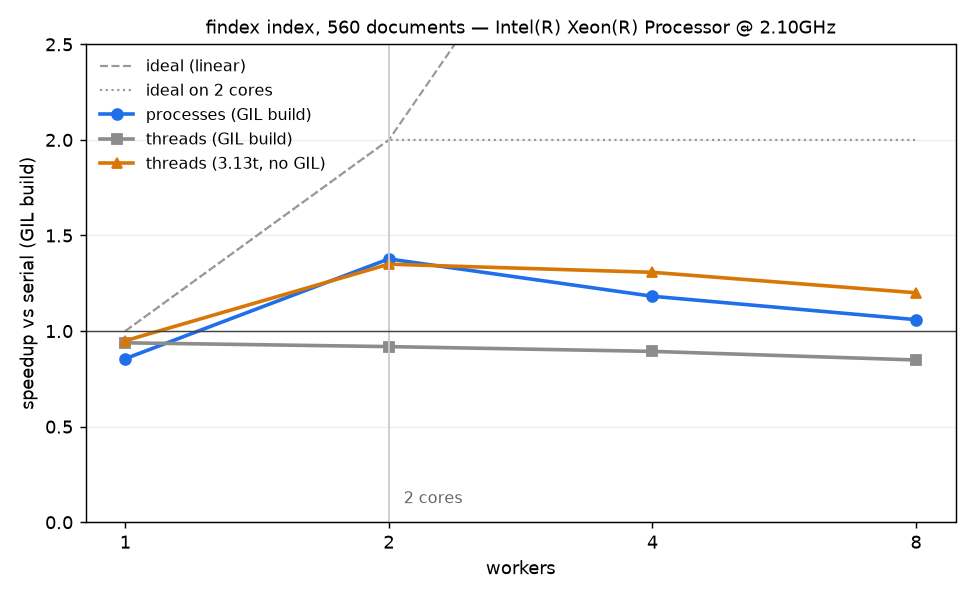
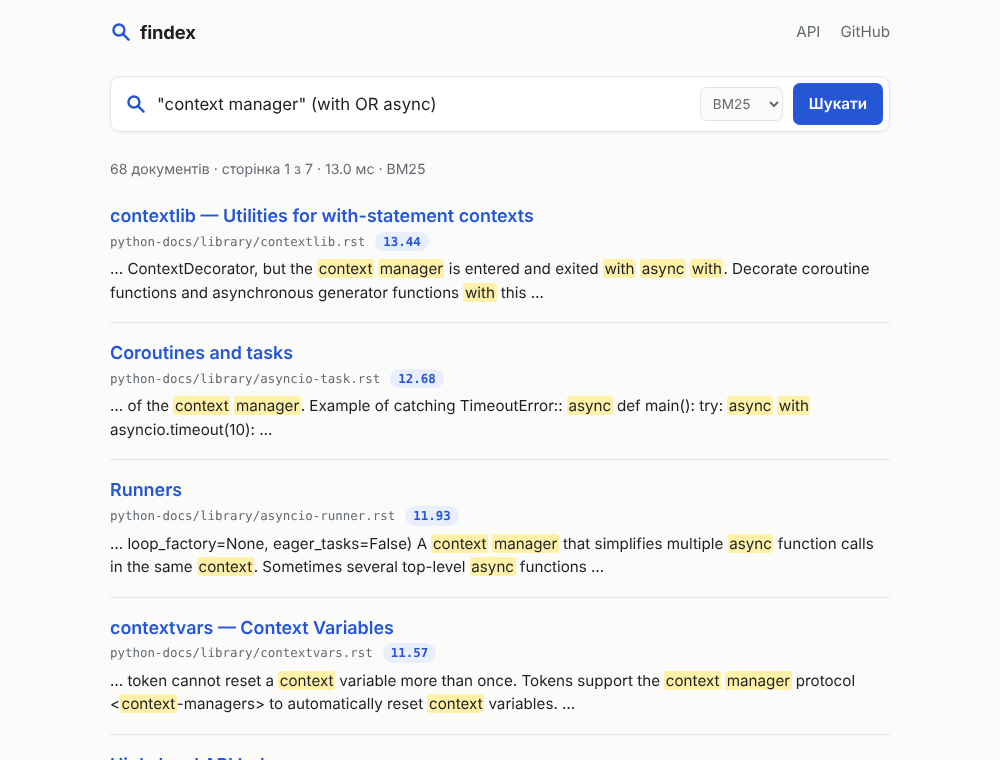

# findex

[](https://github.com/Giovann1g/findex/actions/workflows/ci.yml)

Власна повнотекстова пошукова система, яку я будую протягом семестру в курсі
[Python — Build a Search Engine](https://github.com/rmalkevy/Programming-Practice-Projects/blob/main/courses/python/README.md).
Кожна лабораторна додає один крок; стан після кожної позначено git-тегом (`lab-01`, `lab-02`, …).

**Онлайн: <https://findex-6dl0.onrender.com>** — пошук у браузері · API: [`/docs`](https://findex-6dl0.onrender.com/docs) · [`/health`](https://findex-6dl0.onrender.com/health)
(Render, безкоштовний план: після 15 хвилин без запитів сервіс засинає, і перше відкриття чекає до хвилини).
З лаби 4 це встановлюваний пакет з командою `findex` (реліз `v0.4.0`); з лаби 5 індекс
будується паралельно (`--executor processes`, за замовчуванням); з лаби 6 корпус можна
зібрати асинхронним краулером (`findex crawl`); з лаби 7 це вебсервіс (`findex serve`, реліз `v0.7.0`).

## Встановлення

```bash
uv tool install .                         # з клону репозиторію: findex з'являється в PATH
uv tool install https://github.com/Giovann1g/findex/releases/download/v0.7.0/findex-0.7.0-py3-none-any.whl
uv build && uv tool install dist/findex-0.7.0-py3-none-any.whl     # або з локально зібраного wheel
docker build -t findex . && docker run --rm -p 8000:8000 findex  # або контейнер (Lab 7)
findex --help
```

## Корпус

**Документація CPython** — вихідні `.rst`-файли каталогу
[`Doc/`](https://github.com/python/cpython/tree/main/Doc) репозиторію `python/cpython`
(гілка `main`, коміт `386d9d0`, жовтень 2026).

| Параметр | Значення |
|---|---|
| Документів | 560 файлів `.rst` (1 файл = 1 документ) |
| Обсяг | ≈ 15 МБ тексту |
| Мова | англійська + фрагменти коду |

Чому саме він: це текст, яким я реально користуюсь щодня, тож шукати по ньому цікаво
(«де описано `casefold`?»). До кінця курсу корпус буде розширено до ~1 000 документів /
~50 МБ (переклади документації та сторінки, зібрані async-краулером у Lab 6).

**Як отримати** (каталог `data/` у `.gitignore`, корпус у git не потрапляє):

```bash
./scripts/get_corpus.sh      # sparse-clone cpython/Doc → data/python-docs/
```

## Запуск

```bash
findex serve --index index.pkl --port 8000             # Lab 7: http://127.0.0.1:8000/ і /docs
findex crawl https://books.toscrape.com/ --max-pages 200   # Lab 6: сторінки → data/crawl.jsonl
findex index data/crawl.jsonl -o crawl.pkl --positions # зібране індексується вже поза циклом подій
findex index data/ --out index.pkl --positions        # індекс (смуга прогресу rich)
findex index data/ -o index.pkl --executor threads -j 4   # Lab 5: serial | threads | processes
findex search index.pkl 'python AND (async OR await) NOT java "event loop"'
findex search index.pkl "unicode normalization" --scorer tfidf -k 5 --json | jq .title
findex stats index.pkl --top 20
findex -vv search index.pkl "dict hash"                # DEBUG: @timed і кеш запитів у stderr

# розробка
uv sync                                                # проєкт + dev-інструменти з uv.lock
uv run pytest                                          # 243 тести; -m "not slow" — швидко
uv run pytest --cov                                    # покриття
uv run pyright && uv run ruff check . && uv run ruff format --check .

# дослідницькі скрипти, що друкують таблиці для README
uv run python -m findex.stats data/ [--mode eager]     # Lab 1: eager vs lazy
uv run python -m findex.bench data/ --limits 50 150 300 0
uv run python -m findex.bench_index data/              # Lab 2: пам'ять і формати
uv run python -m findex.bench_search index.bin         # Lab 2: merge vs set
uv run python -m findex.sanity index.pkl               # Lab 3: три перевірки рейтингу
uv run python -m findex.evaluate index.pkl eval/queries.json   # Lab 3: precision@5
uv run python -m findex.bench_parallel data/ --ft .venv-ft/bin/python   # Lab 5: таблиця + графік
uv run python -m findex.bench_parallel data/ --io 10   # Lab 5: I/O-bound для порівняння
uv run python -m findex.race data/                     # Lab 5: гонка на спільному Counter
./scripts/build_mirror.sh                              # Lab 6: локальне дзеркало docs.python.org
uv run python -m findex.crawler.mirror data/mirror --port 8000  # Lab 6: сервер із затримкою і збоями
uv run python -m findex.crawler.bench data/mirror      # Lab 6: таблиця concurrency 1 / 5 / 20
uv run python -m findex.web.bench index.pkl            # Lab 7: def vs async def, таблиця oha
```

Розділи лаб 2–3 нижче показують команди тих версій (`python -m findex.index`,
`python -m findex.search`); з v0.4.0 це `findex index` і `findex search`.

## Структура

```
pyproject.toml   метадані (PEP 621), залежності, група dev, [project.scripts], ruff/pyright/pytest
uv.lock          точні версії всіх залежностей (комітиться)
.github/workflows/
  ci.yml         push і PR: uv sync, ruff, ruff format, pyright, pytest + перевірка wheel; docker build + /health
  release.yml    тег v*: uv build і wheel + sdist у GitHub Release
  loadtest.yml   вручну (Run workflow): oha проти розгорнутого сервісу, таблиця в summary
src/findex/
  cli.py       typer-застосунок: findex index / search / stats; логування — лише тут  # Lab 4
  __main__.py  python -m findex == findex
  corpus.py    iter_documents(root) -> Iterator[Document]   # генератор, 1 файл за раз
  tokenize.py  tokenize(text) -> Iterator[str]              # генератор на re.finditer
  index.py     Posting, DocMeta, Index (Mapping), build_index
  parallel.py  build_partial, merge, make_chunks, run_chunks, build_parallel         # Lab 5
  merge.py     intersect / union / difference, рушії merge і set
  query.py     Term/Phrase/And/Or/Not, лексер, парсер рекурсивним спуском
  rank.py      Scorer (Protocol), TfIdf, BM25, SearchResult, search (heapq.nlargest)
  snippets.py  вікно ±80 символів навколо найкращого збігу, підсвітка
  store.py     save/load/open_index: pickle, json, власний .bin (array)
  timing.py    @timed (functools.wraps, ParamSpec)
  stats.py, bench.py, bench_index.py, bench_search.py, sanity.py, evaluate.py — дослідницькі скрипти
  bench_parallel.py, race.py — дослідницькі скрипти Lab 5 (таблиця, графік, гонка)
  crawler/                                                                      # Lab 6
    fetch.py    fetch(): asyncio.timeout, повтори 429/5xx/таймаут з backoff + jitter, Retry-After
    robots.py   RobotsCache: robots.txt один раз на хост, Crawl-delay
    urls.py     canonicalize(), allowlist доменів
    extract.py  заголовок, текст і посилання (selectolax)
    crawl.py    crawl(): асинхронний генератор, Queue + TaskGroup, семафори, пауза на хост
    run.py      crawl_to_jsonl(): сторінка → рядок JSON одразу, як прийшла
    mirror.py   локальний сервер-дзеркало із затримкою, robots.txt і навмисними збоями
    bench.py    бенчмарк concurrency 1 / 5 / 20 і порівняння з підходом Lab 5
    inline_demo.py  експеримент: індексація всередині циклу подій і що бачить debug-режим
  web/                                                                          # Lab 7
    app.py      create_app(), lifespan (індекс — один раз), middleware: request id і чистий 500
    api.py      GET /search, /docs/{doc_id}, /stats, /health
    ui.py       GET / і /doc/{doc_id}: Jinja2 + htmx
    service.py  run_search, get_document, IndexHolder — без FastAPI, на dataclass-ах лаб 2–3
    models.py   Pydantic-моделі лише на межі (вхід/вихід API)
    deps.py     Depends: get_index, get_holder, налаштування
    settings.py Settings(BaseSettings): INDEX_PATH, CORPUS_ROOT, LOG_LEVEL, LOG_FORMAT
    logs.py     логи в stdout з request id; text або json
    bench.py    20 одночасних запитів: def / async def / to_thread; таблиця oha
    templates/, static/  сторінки, CSS, htmx
docs/lab05/
  parallel.json  сирі результати бенчмарку (усі медіани, min..max, машина, IPC)
  speedup.png    графік прискорення
docs/lab06/
  crawl_bench.json  сирі результати бенчмарку краулера
  failures.log      рядки crawl.log з обробленими збоями
docs/lab07/
  load.json         сирі результати: 20 одночасних запитів і oha
  search-page.png   як виглядає сторінка пошуку
Dockerfile          три етапи: залежності з uv.lock → корпус + індекс → slim-образ, не root
render.yaml         Blueprint для Render: Docker, free, /health як перевірка
scripts/
  get_corpus.sh     корпус .rst (лаби 1–5)
  build_mirror.sh   HTML-дзеркало docs.python.org для краулера (Lab 6)
eval/
  queries.json 10 запитів з ручною розміткою релевантних документів
tests/
  conftest.py       спільний корпус на диску + свіжий індекс на кожен тест       # Lab 4
  test_pipeline.py  збірка на корпусі з conftest, Unicode, фрази, рейтинг обох скорерів  # Lab 4
  test_cli.py       findex через typer.testing.CliRunner: вивід, --json, -vv, помилки  # Lab 4
  test_properties.py  5 властивостей Hypothesis                                # Lab 4
  test_parallel.py  serial merge == Lab 4, усі executors однакові, падіння воркера, spawn  # Lab 5
  test_crawler.py   fetch/robots/crawl через httpx.MockTransport, CLI проти локального дзеркала # Lab 6
  test_web.py       усі маршрути через TestClient + dependency_overrides, 422/404/503/500  # Lab 7
  test_tokenize.py, test_corpus.py, test_index.py, test_model.py, test_query.py, test_rank.py
```

`iter_documents` підтримує дерево каталогів (`*.txt`, `*.md`, `*.rst`, а також їхні `*.gz`),
один JSON-lines файл (`*.jsonl`, `*.jsonl.gz`) або окремий текстовий файл. Файл із
некоректним UTF-8 не зупиняє обробку: невалідні байти замінюються на `�`, подія логується.

## Правила токенізації

Нормалізація (у такому порядку):

1. `unicodedata.normalize("NFC", …)` — `e` + U+0301 і `é` (U+00E9) стають однаковими.
2. `str.casefold()` (не `lower()`): `Straße` → `strasse`.
3. Типографські апострофи `’ ‘ ʼ` → ASCII `'`; м'який перенос U+00AD видаляється.
4. Комбіновані знаки, що лишилися після NFC (наголос у `мо́ва` — для кириличної «о» з
   акутом немає готового символу), видаляються, інакше `\w` розрізав би слово навпіл.
   Літери `й`, `ї` після NFC є єдиними символами і не страждають.

Що є токеном (регулярка `[^\W_]+(?:['_][^\W_]+)*`):

| Випадок | Правило | Приклад |
|---|---|---|
| Літери/цифри | будь-які Unicode-літери й цифри | `Привіт` → `привіт` |
| Апострофи | лишаються **всередині** слова, по краях відкидаються | `don't`, `п’ять` → `п'ять`; `'hi'` → `hi` |
| Дефіси | **розділяють** слово | `state-of-the-art` → `state`,`of`,`the`,`art` |
| Цифри | окремі токени; крапка розділяє | `3.13` → `3`,`13`; `utf8` — один токен |
| Підкреслення | всередині слова лишаються (ідентифікатори) | `sys_path`; `__init__` → `init` |
| Решта | розділювачі | `Hi!!! (yes)` → `hi`,`yes` |

## Результати на повному корпусі

```
documents:   560
tokens:      1,808,119
vocabulary:  41,008
elapsed:     2.63 s   (без tracemalloc; 7.85 s з трасуванням)
peak memory: 7.8 MiB
```

Топ-10: `the` 98 885 · `a` 41 155 · `to` 36 669 · `is` 34 239 · `of` 29 103 · `and` 28 057 ·
`in` 25 325 · `for` 19 773 · `class` 16 002 · `be` 15 515. Повний топ-50 друкує
`python -m findex.stats data/`. Помітні «документаційні» терми: `func`, `meth`, `mod` —
це ролі reStructuredText (`:func:`…``), які в наступних лабах варто відфільтрувати.

## Вимірювання: eager vs lazy

Python 3.13, Linux x86-64. Кожен запуск — окремий процес. Пікова пам'ять — `tracemalloc`;
час — найкращий із 3 запусків **без** трасування (трасування саме уповільнює код у 3–4 рази,
тому його час наведено окремо).

| Version | Documents | Tokens | Peak memory | Elapsed | Elapsed (traced) |
|---|---:|---:|---:|---:|---:|
| eager (lists) | 50 | 84,582 | 5.4 MiB | 0.13 s | 0.49 s |
| lazy (generators) | 50 | 84,582 | 1.5 MiB | 0.13 s | 0.48 s |
| eager (lists) | 150 | 415,333 | 25.1 MiB | 0.50 s | 2.03 s |
| lazy (generators) | 150 | 415,333 | 3.0 MiB | 0.51 s | 1.43 s |
| eager (lists) | 300 | 792,713 | 47.9 MiB | 0.93 s | 3.30 s |
| lazy (generators) | 300 | 792,713 | 3.3 MiB | 0.95 s | 2.98 s |
| **eager (lists)** | **560** | **1,808,119** | **109.3 MiB** | **2.58 s** | 9.36 s |
| **lazy (generators)** | **560** | **1,808,119** | **7.8 MiB** | **2.63 s** | 7.85 s |

**Куди пішла пам'ять.** Жадібна версія тримає в RAM одночасно три речі. (1) Тексти всіх
560 документів — ≈ 18 МіБ (більше за 15 МБ на диску, бо `str` з не-ASCII символом зберігається
по 2–4 байти на символ). (2) Головний споживач — ≈ 1,7 млн окремих об'єктів `str` для
токенів, ≈ 75 МіБ: кожне слово, навіть трилітерне `the`, — це окремий об'єкт із ~50 байтами
заголовка, а `re` створює новий об'єкт на кожен збіг, тож 98 тисяч `the` — це 98 тисяч копій.
(3) Самі списки — ≈ 15 МіБ: по 8-байтовому вказівнику на кожен токен. Разом ≈ 110 МіБ, що
збігається з виміряними 109 МіБ, і росте лінійно з розміром корпусу (у 3,6 раза більше за lazy
на 50 документах, у 14 разів — на повному корпусі). У лінивій версії всі проміжні стадії — потоки: у будь-який момент живі лише
поточний документ, поточний токен і `Counter`. Пам'ять лінивої версії не нульова, бо
`Counter` — це відповідь, і він легітимно росте зі словником (41 тис. ключів ≈ 3 МіБ), а
найбільший документ разом з його нормалізованими копіями (NFC, `casefold`, `translate`,
`re.sub` — кожна повертає новий рядок) займає ще кілька МіБ; саме тому пік зростає
стрибкоподібно, коли до вибірки потрапляє великий файл. Час однаковий: роботу (регулярка
+ нормалізація) виконано ту саму, генератори лише не зберігають проміжні результати.

---

# Лаба 2 — інвертований індекс

## Що побудовано

`build_index(docs)` за **один прохід** по лінивому конвеєру з лаби 1 будує:

| Структура | Тип | Для чого |
|---|---|---|
| `postings` | `dict[str, list[Posting]]` | терм → постінги, **відсортовані за `doc_id`** |
| `doc_lengths` | `dict[int, int]` | кількість токенів документа (BM25 у лабі 3) |
| `doc_meta` | `dict[int, DocMeta]` | шлях і заголовок для показу результату |

```python
@dataclass(frozen=True, slots=True)
class Posting:
    doc_id: int
    tf: int
    positions: tuple[int, ...] | None = None  # лише з --positions


@dataclass(frozen=True, slots=True)
class DocMeta:
    doc_id: int
    path: str
    title: str  # перший заголовок reST, ролі на кшталт :mod:`!x` прибрано
```

Обидва класи незмінні та хешовані, тож їх можна класти в `set` (тест
`test_records_are_frozen_slotted_hashable`). Постінги збираються в `defaultdict(list)`.
Для кожного документа рахується окремий `Counter`, який після кінця документа «зливається»
в постінги й відкидається. `doc_id` — це щільні числа `0..N-1` у порядку потоку, і кожен
документ дописується **після** попередніх. Тому кожен список постінгів відсортований
за побудовою, окреме сортування не потрібне.

Повний корпус: **560 документів, 41 008 термів, 328 804 постінги** (у середньому 8 на терм).

## Boolean-пошук

```
query   := operand (op operand)*        # обчислюється зліва направо, без пріоритетів
op      := AND | OR | <нічого> (= AND)
operand := [NOT] слово
```

Оператори пишуться ВЕЛИКИМИ літерами, малі `and`/`or`/`not` — звичайні слова. Кожне слово
проходить той самий `tokenize`, що й корпус (`Straße` знайде `strasse`), а слово з дефісом
стає AND своїх частин. `NOT x` на початку дає доповнення до всіх документів.

* `--engine merge` — двовказівникові `intersect` / `union` / `difference`, O(m + n), без хешування;
* `--engine set` — `set(a) & set(b)` / `|` / `-`, потім `sorted`.

```text
$ uv run python -m findex.search index.bin "generator NOT async" --show 3
query:   'generator NOT async'  -> [('generator',), ('async',)]
hits:    54 of 560 documents   [engine=merge]
      4  About this documentation                                      python-docs/about.rst
     20  Pending removal in Python 3.21                                python-docs/deprecations/pending-removal-in-3.21.rst
     32  secrets --- Generate secure random numbers for managing secr  python-docs/library/secrets.rst
  ... and 51 more
load:    517.1 ms
query:   1.081 ms
peak memory: 21.6 MiB
```

CLI міряє час під увімкненим `tracemalloc` (щоб заразом показати пік пам'яті), тому
він більший за чисті цифри в таблицях нижче: той самий `load` без трасування — 68 мс.

### Бенчмарк merge vs set

Вимірюється лише сама булева операція (найкращий із 5 × 2000 викликів). Обидва движки
отримують ті самі списки `doc_id`. Пару рідкісних термів вибрано з hapax legomena (df = 1,
tf = 1) з фіксованим seed.

| Terms | df | Op | Hits | merge, µs | set, µs | Faster | merge+bisect, µs |
|---|---|---|---:|---:|---:|---|---:|
| 2 most common: `the`, `in` | 552, 536 | AND | 535 | 40.89 | 22.97 | set ×1.8 | 50.20 |
| 2 most common: `the`, `in` | 552, 536 | OR | 553 | 41.33 | 20.35 | set ×2.0 | — |
| 2 most common: `the`, `in` | 552, 536 | AND NOT | 17 | 35.66 | 14.14 | set ×2.5 | — |
| 2 rarest: `whitacre`, `throttle` | 1, 1 | AND | 0 | 0.14 | 0.23 | merge ×1.7 | 0.13 |
| 2 rarest: `whitacre`, `throttle` | 1, 1 | OR | 2 | 0.24 | 0.28 | merge ×1.2 | — |
| 2 rarest: `whitacre`, `throttle` | 1, 1 | AND NOT | 1 | 0.20 | 0.25 | merge ×1.3 | — |
| common + rare: `the`, `whitacre` | 552, 1 | AND | 1 | 27.81 | 4.86 | set ×5.7 | 0.23 |
| common + rare: `the`, `whitacre` | 552, 1 | OR | 552 | 32.29 | 10.59 | set ×3.0 | — |
| common + rare: `the`, `whitacre` | 552, 1 | AND NOT | 551 | 31.82 | 10.58 | set ×3.0 | — |

**Чому так.** Асимптотика однакова, O(m + n): merge проходить обидва списки, а set хешує
обидва. На довгих списках виграє `set` приблизно вдвічі, бо хешування й перетин написано
на C, а цикл merge виконує інтерпретатор Python, ~10 байткод-операцій на крок. На
коротких списках виграє merge: `set` платить фіксовану ціну за створення двох множин і
`sorted`, а merge робить один-два порівняння. На перекошеній парі (552 і 1) звичайний merge
усе одно проходить усі 552 елементи. Справжні рушії тут роблять «галоп» (skip pointers):
двійковий пошук кожного id короткого списку в довгому, O(m log n). Колонка `merge+bisect`
показує 0,23 мкс — у 21 раз швидше за set. Крім того, merge не потребує пам'яті під
множини і може працювати потоково, а set — ні.

## Збереження: три формати

`store.save(index, path)` / `store.load(path)`, формат визначається за розширенням.

* **`pickle`** (`.pkl`) — увесь граф об'єктів `Index`. ⚠️ **Ніколи не завантажуйте чужий
  `.pkl`.** Pickle — це не дані, а програма для віртуальної машини pickle: опкод `REDUCE`
  викликає будь-яку функцію, яку можна імпортувати, з будь-якими аргументами. Тож
  підроблений файл виконає, наприклад, `os.system(...)` вже в момент `pickle.load`.
  Попередження також є в `store.py`.
* **`json`** (`.json`) — безпечний і читабельний; постінги як пари `[doc_id, tf]`.
* **`bin`** (`.bin`) — власний формат на `array('I')`: `b"FIDX"` + версія + JSON-заголовок
  (`[term, offset, count]`, метадані) + усі `doc_id` підряд + усі `tf` підряд (uint32 LE).
  `load(path, lazy=True)` / `findex.search --lazy` робить `mmap` файлу і декодує постінги
  терму лише тоді, коли запит його торкається.

| Format | Loads into | File size | Save | Load | Index in RAM after load |
|---|---|---:|---:|---:|---:|
| `pickle` of `slots` | `list[Posting]` (slots) | 5.6 MiB | 1355 ms | 704.6 ms | 32.8 MiB |
| `pickle` of `array` | `array` pairs | 4.4 MiB | 149 ms | 85.4 ms | 15.2 MiB |
| `json` | `list[Posting]` (slots) | 3.1 MiB | 941 ms | 490.4 ms | 31.7 MiB |
| `bin` | `array` pairs | 3.5 MiB | 119 ms | 68.1 ms | 14.0 MiB |
| `bin` (`--lazy`) | lazy `mmap`, decoded per term | 3.5 MiB | 119 ms | 56.4 ms | 6.3 MiB |

`json` виявився навіть меншим за `bin`. Причина: у JSON мале число займає 1–3 байти
(`[12,3]`), а в `bin` кожне — рівно 4 байти. Стиснення різниць між сусідніми `doc_id`
(gap encoding, stretch) зробило б `bin` суттєво меншим. Час завантаження `bin` --lazy майже
весь іде на розбір JSON-заголовка (41 тис. термів). Дані постінгів не читаються, доки їх не
попросять.

## Дослідження пам'яті: три представлення постінгів

Той самий корпус, кожен рядок — в окремому процесі (`python -m findex.bench_index data/`).
Пікова пам'ять і «Index in RAM» (що лишилося після побудови) — за `tracemalloc`, час —
найкращий із 3 запусків без трасування. Файл — `pickle` відповідного представлення.

| Postings representation | Peak memory (build) | Index in RAM | Build | Pickle file | Save | Load |
|---|---:|---:|---:|---:|---:|---:|
| `list[Posting]`, plain `@dataclass` | 40.3 MiB | 39.2 MiB | 2.90 s | 7.5 MiB | 429 ms | 261 ms |
| `list[Posting]`, `slots=True` | 28.4 MiB | 26.6 MiB | 2.83 s | 5.6 MiB | 1062 ms | 622 ms |
| `array('I')` pairs (doc_ids, tfs) | 19.1 MiB | 15.3 MiB | 2.77 s | 4.4 MiB | 126 ms | 70 ms |
| `list[Posting]`, `slots=True` + positions | 99.2 MiB | 97.8 MiB | 3.70 s | 11.0 MiB | 1949 ms | 1059 ms |

**Куди пішли байти** (виміряно на 1 млн екземплярів і перевірено на індексі):

* **Plain dataclass — ≈ 104 Б на постінг**: 8 Б на слот у списку + ≈ 96 Б сам об'єкт
  (заголовок, вказівник на тип, керований `__dict__` з місцем під атрибути). Цілі числа
  майже нічого не коштують: `tf` здебільшого < 257 (кешовані малі int), а один об'єкт
  `doc_id` спільний для всіх постінгів документа.
* **`slots=True` — ≈ 64 Б на постінг**: 8 Б слот + 56 Б об'єкт (заголовок 16 Б + три
  слоти по 8 Б, без `__dict__`). Різниця 40 Б × 328 804 = 12,6 МіБ, що точно збігається
  з 39,2 − 26,6. Ціна: не можна додати атрибут, якого немає у `__slots__`.
* **`array('I')` — 8 Б корисних даних на постінг** (два uint32), але кожен терм має два
  об'єкти `array` по ~80 Б заголовка плюс запас на дописування. При 8 постінгах на терм
  заголовки (≈ 7 МіБ) переважують дані (2,5 МіБ). Тому виграш лише 1,7×, а не 8×. Решта
  15,3 МіБ — словник на 41 тис. термів (0,9 МіБ), самі рядки-терми (2,0 МіБ) і `doc_meta`.
  Один спільний масив зі зсувами, як у `.bin`, прибрав би цю ціну.
* **Позиції — +71 МіБ (×3,7)**: 1,8 млн позицій, і кожна — окремий `int` > 256
  (32 Б об'єкт + 8 Б слот у кортежі), плюс заголовки 328 тис. кортежів. У файлі це лише
  +5,4 МіБ, бо pickle пише числа компактно. Через це позиції вмикаються прапорцем `--positions`.
* **Чому pickle `slots` повільніший за plain.** Для `slots=True` dataclass генерує
  Python-функції `__getstate__`/`__setstate__`, і pickle викликає їх для кожного з 328 тис.
  об'єктів. Звичайний екземпляр pickle серіалізує через `__dict__` на C-шляху.
  `array` серіалізується одним блоком байтів, тому він найшвидший.

## REPL-експерименти

| Експеримент | Результат |
|---|---|
| `sys.getsizeof` dict під час вставки | розширення на 1, 6, 11, 22, 43, 86, 171 ключах (≈ ⅔ заповнення) |
| `__hash__` повертає константу | 1 000 ключів: 34,8 мс проти 0,3 мс; 2 000: 120 мс (×3,5 за ×2 даних — O(n²)) |
| `__eq__` без `__hash__` | `Cls.__hash__ is None` — клас стає нехешованим |
| `hash("hello")` у двох запусках | різні значення; з `PYTHONHASHSEED=0` — однакові |
| `{[1]: 1}`, `hash((1, [2]))` | `TypeError: unhashable type: 'list'` |
| 1 млн екземплярів (+ слот + int) | plain 136 Б, slots 96 Б на елемент |
| `list` vs `array('I')` з 1 млн int | 40 Б vs 4,1 Б на елемент |

---

# Лаба 3 — модель об'єктів і ранжування

## `Index` як об'єкт Python

Словники з лаби 2 тепер сховані за класом `Index(collections.abc.Mapping)`: терм → постінги.
Три абстрактні методи (`__getitem__`, `__iter__`, `__len__`) дають від `Mapping` безкоштовно
`keys()`, `items()`, `values()`, `get()` і `==`. `__contains__` перевизначено лише заради
швидкості: один пошук у словнику замість `try/except KeyError`.

| Вираз | Що викликається | Результат на корпусі |
|---|---|---|
| `len(ix)` | `__len__` — кількість **термів** | 41 008 |
| `"python" in ix` | `__contains__` | `True` |
| `ix["heapq"][0]` | `__getitem__`; невідомий терм → `KeyError` | `Posting(doc_id=8, tf=3, positions=(6098, 6101, 6104))` |
| `for t in ix` | `__iter__` | терми |
| `repr(ix)` | `__repr__` | `Index(terms=41,008, docs=560, layout='slots', positions)` |
| `ix.num_docs` | `@property` | 560 |
| `ix.avg_doc_length` | `@cached_property` — рахується один раз | 3 228,8 |
| `ix.df("python")` | | 460 |
| `bool(Index({}, {}, {}))` | `__bool__` немає → `__len__` | `False` |

`open_index(path)` — контекст-менеджер на `@contextmanager`: усе до `yield` виконується на
вході, `finally` — на виході, навіть якщо тіло `with` кинуло виняток чи зробило `return`.
Для лінивого `.bin` він закриває `mmap` (тест `test_open_index_closes_even_on_error`).

```python
>>> with open_index("index.pkl") as ix:
...     for r in ix.search('python AND (async OR await) NOT java "event loop"', k=3):
...         print(r)
[findex.timed] load took 996.4 ms
[findex.index] match cache miss: (((python AND (async OR await)) AND NOT java) AND "event loop") -> 22 docs
[findex.timed] search took 0.8 ms
SearchResult(doc_id=416, score=18.482049750219783, title='A conceptual overview of asyncio')
SearchResult(doc_id=211, score=18.26804768015061, title='Developing with asyncio')
SearchResult(doc_id=338, score=18.146703377271198, title='Coroutines and tasks')
>>> ix
Index(terms=41,008, docs=560, layout='slots', positions, closed)
```

**Пастка, знайдена по дорозі.** `python -m findex.index` виконує файл як модуль `__main__`,
тому pickle записував клас як `__main__.Index` — і жодна інша програма не могла такий файл
прочитати (`AttributeError: Can't get attribute 'Index' on <module 'findex.search'>`). Тепер
блок `if __name__ == "__main__"` викликає `main()` з імпортованого `findex.index`.

## Ранжування: `Scorer`, TF-IDF, BM25

`Scorer` — це `typing.Protocol` з одним методом `score(term, posting, index) -> float`.
`TfIdf` і `BM25` його не наслідують: `search` покладається лише на наявність методу
(duck typing), а `@runtime_checkable` дозволяє ще й `isinstance(x, Scorer)`.

```
TfIdf:  (1 + ln tf) · ln(N / df)
BM25:   idf · tf·(k1 + 1) / (tf + k1·(1 − b + b·dl/avgdl)),   idf = ln(1 + (N − df + 0.5)/(df + 0.5))
```

`search(index, query, scorer=BM25(), k=10)`: дерево запиту визначає, *які* документи
підходять; кожен позитивний терм (не під `NOT`) додає `scorer.score` кожному з них;
`heapq.nlargest(k, …)` бере топ-k за O(n log k) замість повного сортування O(n log n).
Результати — `SearchResult(doc_id, score, title)` з `order=True`: порівнюється лише
прихований `rank_key = (−score, doc_id)`, тож `sorted(results)` — від найкращого.

### Три sanity-check на корпусі (`python -m findex.sanity index.pkl`)

Index: `Index(terms=41,008, docs=560, layout='slots', positions)`, average document length 3,228.8 tokens.

#### 1. Rare term beats common term: `python OR heapq`

df(`python`) = 460, df(`heapq`) = 16 of N = 560.

| | idf BM25 | idf TF-IDF | one occurrence in an average-length doc, BM25 |
|---|---:|---:|---:|
| `python` | 0.197 | 0.197 | 0.197 |
| `heapq` | 3.526 | 3.555 | 3.526 |

- BM25(k1=1.5, b=0.75): the only document with `heapq` but no `python` (*queue --- A synchronized queue class*, tf=1, 1,803 tokens) is ranked **#12** of 461; it outranks **445 of 445** documents that contain only `python`.
- TfIdf(): the only document with `heapq` but no `python` (*queue --- A synchronized queue class*, tf=1, 1,803 tokens) is ranked **#16** of 461; it outranks **445 of 445** documents that contain only `python`.

#### 2. Saturation: term `coroutine` in a document of average length (3,229 tokens)

| tf | BM25 score | BM25: added by the tf-th occurrence | TF-IDF score | TF-IDF: added |
|---:|---:|---:|---:|---:|
| 1 | 2.350 | 2.3500 | 2.358 | 2.3576 |
| 2 | 3.357 | 1.0072 | 3.992 | 1.6342 |
| 3 | 3.917 | 0.5595 | 4.948 | 0.9559 |
| 5 | 4.519 | 0.2465 | 6.152 | 0.5261 |
| 10 | 5.109 | 0.0730 | 7.786 | 0.2484 |
| 20 | 5.465 | 0.0200 | 9.421 | 0.1209 |
| 50 | 5.704 | 0.0034 | 11.581 | 0.0476 |

Under BM25 the 20th occurrence adds **0.0200**, 0.9% of what the first one added, and the score can never pass idf·(k1+1) = 5.875. TF-IDF's 1 + ln tf also flattens (5.1% for the 20th), but has no ceiling: at tf = 50 it is 4.9× the single-occurrence score, BM25 only 2.4×.

#### 3. Length normalization: query `hashing`

`hashing` occurs exactly once in *Pending removal in Python 3.19* (16 tokens) and once in *Built-in Types* (32,784 tokens, ×2049 longer).

| Scorer | score short | score long | rank short | rank long |
|---|---:|---:|---:|---:|
| BM25(k1=1.5, b=0.75) | 5.824 | 0.628 | 4 | 22 |
| BM25(k1=1.5, b=0.0) | 3.216 | 3.216 | 12 | 19 |
| TfIdf() | 3.237 | 3.237 | 12 | 19 |

With `b = 0` and with TF-IDF the two scores are equal (the tie is broken by doc id); only BM25's length normalization puts the short document ahead.

## Мова запитів (`query.py`)

```
or_expr  := and_expr ("OR" and_expr)*
and_expr := not_expr (["AND"] not_expr)*       # два операнди поруч = AND
not_expr := "NOT" not_expr | atom
atom     := WORD | "фраза" | "(" or_expr ")"
```

Один метод парсера — одне правило граматики, тому пріоритет (`NOT` > `AND` > `OR`) задається
глибиною виклику. Вузли `Term`, `Phrase`, `And`, `Or`, `Not` — frozen-dataclass-и з `&`, `|`,
`~`, і парсер будує дерево саме цими операторами. Тести порівнюють **дерева**:

```python
parse("a OR b c") == Or(Term("a"), And(Term("b"), Term("c")))
parse('python AND (async OR await) NOT java "event loop"') == (
    (Term("python") & (Term("async") | Term("await"))) & ~Term("java")
) & Phrase(("event", "loop"))
```

Слова проходять той самий токенізатор, що й корпус (`Straße` → `strasse`, `3.13` → `3 AND 13`).
Помилки показують місце: `a OR` → `query ends where a word, phrase or '(' was expected` з
кареткою під кінцем рядка. Фрази перевіряються за позиціями: старт `p` першого слова
перетинається з позиціями `i`-го слова, зсунутими на `−i`, тим самим двовказівниковим merge.
`x AND NOT y` обчислюється як різниця, без побудови доповнення `y`.

## `@timed`, `lru_cache` і сніпети

`@timed` (з `functools.wraps`) стоїть на `build_index`, `store.load` і `search`; працює і як
`@timed`, і як `@timed(level=logging.DEBUG)`. Шлях «запит → id документів» кешується
`lru_cache(maxsize=256)` **на рівні екземпляра індексу** (`Index._match_cache`): ключ — дерево
запиту, тому `a b` і `a AND b` потрапляють в один запис, а BM25 і TF-IDF ділять той самий
кеш. `lru_cache` на самому методі не підходить: `Index` нехешований (`Mapping` визначає
`__eq__`), а кеш на класі тримав би живими всі індекси, по яких колись шукали.

```text
$ uv run python -m findex.search index.pkl 'python AND (async OR await) NOT java "event loop"' -k 3 --repeat 2 --mark md
[findex.timed] load took 960.0 ms
[findex.index] match cache miss: (((python AND (async OR await)) AND NOT java) AND "event loop") -> 22 docs
[findex.timed] search took 1.1 ms
[findex.index] match cache hit: (((python AND (async OR await)) AND NOT java) AND "event loop") -> 22 docs
[findex.timed] search took 0.2 ms
[findex.index] match cache hit: (((python AND (async OR await)) AND NOT java) AND "event loop") -> 22 docs
query:  python AND (async OR await) NOT java "event loop"
tree:   And(And(And(Term('python'), Or(Term('async'), Term('await'))), Not(Term('java'))), Phrase('event loop'))
index:  Index(terms=41,008, docs=560, layout='slots', positions)

22 matching documents, top 3 by BM25(k1=1.5, b=0.75):

 1.  18.482  A conceptual overview of asyncio  (python-docs/howto/a-conceptual-overview-of-asyncio.rst)
    … :mod:`!asyncio`: the **event** **loop**, coroutine functions, coroutine objects, tasks, and ``**await**``. ========== **Event** **loop** ========== Everything in :mod:`!asyncio` happens relative …
 2.  18.268  Developing with asyncio  (python-docs/library/asyncio-dev.rst)
    … **event** **loop**, no other Tasks can run in the same thread. When a Task executes an ``**await**`` expression, the running Task gets suspended, and the **event** **loop** executes the next …
 3.  18.147  Coroutines and tasks  (python-docs/library/asyncio-task.rst)
    … get_running_loop() deadline = **loop**.time() + 20 try: **async** with asyncio.timeout_at(deadline): **await** long_running_task() …
```

Повтор того самого запиту: `match cache hit` і 0,2 мс замість 1,1 мс (третій рядок `hit` —
це підрахунок «22 matching documents» для заголовка). Сніпет — вікно ±80 символів навколо
збігу, поруч з яким найбільше *різних* термів запиту (одним проходом ковзного вікна). Позиції
в індексі — порядкові номери токенів, а не зсуви символів, тому текст сканується ще раз і кожне
слово нормалізується тим самим токенізатором: на всьому корпусі розходяться 15 токенів із
1,8 млн (знаки телугу поза діапазоном U+0300–U+036F). У терміналі збіги підсвічуються кольором
(`--mark ansi`), у файлі — `**…**`.

## precision@5: TF-IDF vs BM25 (`python -m findex.evaluate index.pkl eval/queries.json`)

10 запитів, релевантні документи розмічено вручну **до** запуску ранжування (`eval/queries.json`,
там же критерій і обґрунтування). Документ релевантний, якщо він *присвячений* темі, а не
просто згадує слова; сторінки «What's New», покажчики та глосарій — нерелевантні. «Max P@5» —
стеля для запиту, в якого менше 5 релевантних документів.

| # | Query | Relevant | Max P@5 | TF-IDF P@5 | BM25 P@5 |
|---:|---|---:|---:|---:|---:|
| 1 | `asyncio event loop` | 7 | 1.0 | 0.6 | 0.8 |
| 2 | `"context manager"` | 4 | 0.8 | 0.2 | 0.2 |
| 3 | `generator yield` | 4 | 0.8 | 0.4 | 0.4 |
| 4 | `unicode normalization` | 3 | 0.6 | 0.6 | 0.6 |
| 5 | `lru_cache` | 2 | 0.4 | 0.4 | 0.4 |
| 6 | `pickle untrusted data` | 4 | 0.8 | 0.4 | 0.8 |
| 7 | `"global interpreter lock"` | 5 | 1.0 | 0.2 | 0.2 |
| 8 | `regular expression named groups` | 2 | 0.4 | 0.4 | 0.4 |
| 9 | `sort key function` | 4 | 0.8 | 0.6 | 0.2 |
| 10 | `virtual environment` | 3 | 0.6 | 0.4 | 0.4 |
| | **mean** | | **0.72** | **0.42** | **0.44** |

**Що видно.** Загалом BM25 трохи кращий (0,44 проти 0,42 при стелі 0,72), але по запитах
результат різний. BM25 виграє на `pickle untrusted data` (0,8 проти 0,4) завдяки
нормалізації довжини: коротка сторінка *Security Considerations* піднялася на перше місце, а
великий *Built-in Functions* випав. На `asyncio event loop` BM25 так само підняв коротку
сторінку *Runners* (0,8 проти 0,6). Програє BM25 на `sort key function` (0,2 проти 0,6): ті
самі короткі сторінки (`bisect`, `heapq`, `pstats`, 1,3–2,7 тис. токенів, у `bisect` 29 разів
`key`) обходять у 10–25 разів довші, але по суті релевантні *Built-in Types* і *Built-in Functions*. Найслабше місце
обох — **фрази** (`"context manager"`, `"global interpreter lock"`: 0,2): фраза лише відбирає
документи, а бали рахуються за окремими словами, тож `multiprocessing` зі 117 входженнями
`lock` обходить FAQ про GIL (4 входження). Наступний крок — рахувати tf самої фрази.

---

# Лаба 4 — типи, тести, пакування і CLI

`findex` тепер ставиться однією командою (`uv tool install .` або з wheel релізу `v0.4.0`)
і працює з будь-якого каталогу. Перевірки, які проганяє CI на кожен push і PR:

| Перевірка | Результат |
|---|---|
| `pyright` у режимі `strict` (усі 18 модулів `src/findex`) | **0 помилок** |
| `ruff check`, `ruff format --check` | чисто |
| `pytest` | **147 тестів**, з них 5 властивостей Hypothesis |
| покриття (`pytest --cov`, рядки + гілки) | **95 %** |
| wheel у чистому оточенні: `findex --help`, `findex --version` | працює |

## Типи (pyright strict)

* **`Scorer` — це `typing.Protocol`** з одним методом `score(term, posting, index)`. `TfIdf`
  і `BM25` нічого не наслідують: pyright структурно звіряє їхні сигнатури з протоколом.
* **Три види постінгів** (`list[Posting]`, `list[PlainPosting]`, пара `array[int]`) описано
  явним union `PostingList`, а `Index.__getitem__` звужує його через `isinstance(plist, tuple)`.
  Для читання постінгів є протокол `PostingLike` з read-only властивостями: їм відповідають
  поля обох frozen-dataclass-ів.
* **Генератори:** `iter_documents -> Iterator[Document]`, `tokenize -> Iterator[str]`,
  `build_index(docs: Iterable[Document])`. Функції приймають найширший тип (`Iterable`), а
  повертають найточніший (`Iterator`).
* **`Literal`** для всіх рядкових виборів: `Layout`, `Format`, `ScorerName`, `EngineName`.
  Ті самі типи typer перетворює на варіанти в `--help` (`<bm25|tfidf>`).
* **PEP 695:** `type PostingList = …`, `type SetOp = …`, а `@timed` типізовано через
  ParamSpec — `def timed[**P, R](func: Callable[P, R]) -> Callable[P, R]` — тож декорована
  функція зберігає свою сигнатуру для pyright.
* **JSON-файли** (`.json`, заголовок `.bin`, `eval/queries.json`) описано `TypedDict`-ами.
* У `src/` немає жодного `# type: ignore`. У тестах їх три, кожен із коментарем, навіщо він
  (наприклад, присвоєння полю frozen-dataclass навмисне: тест чекає `FrozenInstanceError`).

Що strict-режим знайшов по суті, а не лише формально:

| Знахідка | Виправлення |
|---|---|
| `Phrase.evaluate` ітерував `positions`, які можуть бути `None` | `p.positions or ()` після перевірки `has_positions` |
| `pickle.load` повертає `Any`, тож «індексом» могло стати що завгодно | `isinstance(obj, Index)`, інакше `IndexFileError` |
| `@contextmanager` над `-> Iterator[...]` у typeshed позначено застарілим | `-> Generator[Index]` |
| лямбди в циклах бенчмарка втрачали звужений тип змінних циклу (і ловили б пастку B023) | `functools.partial` |
| `__init__.py` досі містив заготовку `hello()` від `uv init` | опис пакета і `__version__` |

Ще одна знахідка — на межі типів і рантайму. typer читає анотації **під час виконання**, і
псевдонім, створений оператором `type Layout = Literal[...]` (PEP 695), для нього — це об'єкт
`TypeAliasType`, а не `Literal`. Результат — `RuntimeError: Type not yet supported: Layout`.
Тому чотири `Literal`-псевдоніми, що йдуть у CLI, записано звичайним присвоєнням, з коментарем,
чому саме так.

## Тести

| Файл | Тестів | Що перевіряє |
|---|---:|---|
| `test_tokenize.py` | 10 | правила токенізації: регістр, кирилиця, NFC, апострофи, дефіси, цифри |
| `test_corpus.py` | 8 | генератор, биті кодування, `.gz`, JSON-lines, `count_documents`, скрипт `stats` |
| `test_index.py` | 26 | записи, побудова в трьох layout-ах, merge, запити, round-trip усіх форматів |
| `test_model.py` | 10 | `Index` як `Mapping`, `open_index` при винятку, кеш запитів, `@timed` |
| `test_query.py` | 34 | парсер: 18 пар «запит → дерево», помилки з позицією, фрази |
| `test_rank.py` | 15 | скорери, `SearchResult`, сніпети |
| `test_pipeline.py` | 18 | корпус із `conftest.py`: Unicode, фрази, **три перевірки рейтингу для обох скорерів** |
| `test_cli.py` | 21 | `findex` через `CliRunner`: таблиця, `--json`, `-vv`, 10 очікуваних помилок |
| `test_properties.py` | 5 | властивості Hypothesis (нижче) |

**`conftest.py`** записує шість маленьких файлів (і один `.bin`, який має бути пропущений)
один раз за сесію і дає *свіжий* індекс на кожен тест. Каталог корпусу має область
`session`, бо його лише читають. Індекс — область `function`, бо `Index` має змінний стан
(кеш запитів, `cached_property`, `close()`), і спільний індекс протягнув би побічні ефекти
одного тесту в наступний.

**Властивості Hypothesis** — твердження «для будь-якого входу»:

1. `load(save(index))` дає той самий індекс для будь-якого корпусу, у кожному з трьох форматів,
   з позиціями та без.
2. Постінги будь-якого індексу строго зростають за `doc_id`, `tf > 0`, а сума всіх `tf`
   дорівнює сумі довжин документів (кожен токен пораховано рівно раз).
3. `intersect`, `union`, `difference` і `intersect_gallop` збігаються з операціями над `set`
   (оракул) для будь-яких відсортованих списків.
4. Токенізатор на будь-якому Unicode-тексті: жодного порожнього токена чи пробілу всередині, і
   кожен токен — нерухома точка: `tokenize(t) == [t]`. Окремо прогнано на 20 000 прикладах —
   контрприкладу немає.
5. Парсер обертає `str()`: `parse(str(tree)) == tree` для випадкових дерев з `And`/`Or`/`Not`/
   фраз, зокрема зі словами `and`, `or`, `not` у нижньому регістрі.

Маркер `slow` (`pytest -m "not slow"` їх пропускає) стоїть на властивості токенізатора:
~1,4 с на першому запуску, бо 300 довільних Unicode-рядків проходять NFC і `casefold`.

### Покриття: 95 %

```
Name                     Stmts   Miss Branch BrPart  Cover
src/findex/cli.py          162      7     38      4    94%
src/findex/corpus.py        75      2     30      4    94%
src/findex/index.py        186      4     48      5    96%
src/findex/merge.py         85      1     28      0    99%
src/findex/query.py        207      6     66      2    97%
src/findex/rank.py          70      3     18      2    94%
src/findex/snippets.py      88      4     42      7    92%
src/findex/stats.py         74      1     16      1    98%
src/findex/store.py        175     13     34      6    91%
src/findex/timing.py        24      0      2      0   100%
src/findex/tokenize.py      21      0      4      0   100%
TOTAL                     1169     42    326     31    95%
```

**Що навмисно поза покриттям і чому:**

* **Дослідницькі скрипти** `bench*.py`, `sanity.py`, `evaluate.py` виключено в
  `[tool.coverage.run] omit`. Вони запускають справжній 15-мегабайтний корпус у підпроцесах і
  друкують таблиці для README. Їхній результат перевіряється тим, що таблиці відтворюються, а
  не unit-тестами, а корпус у CI не завантажується.
* **Гілки big-endian** у `store.py` (`byteswap()`): CI і розробка — x86-64, little-endian.
* **Обгортки несподіваних винятків** у `store.load` (`AttributeError`, `ImportError` з pickle,
  `struct.error`): вони перетворюють збій на одну зрозумілу помилку, а відтворити кожен
  варіант битого файлу дорожче, ніж варто.
* **`findex --version` без встановленого пакета**, `NotImplementedError` у базовому `Node`,
  `__repr__` кількох вузлів — гілки, що не несуть логіки.

## CLI

```
findex [-v|-vv] index  CORPUS --out FILE [--positions] [--limit N] [--layout …] [--format …]
                       [--executor serial|threads|processes] [-j|--workers N]
findex crawl SEED_URL... [--max-pages 500] [-c|--concurrency 10] [--per-host 2] [--delay 0.5]
                       [-o data/crawl.jsonl] [--log crawl.log] [--allow-domain D] [--debug]
findex serve [--index FILE] [--host 127.0.0.1] [--port 8000] [-w|--workers 1]   # HOST/PORT/WEB_CONCURRENCY з оточення
findex [-v|-vv] search INDEX "QUERY" [-k 10] [--scorer bm25|tfidf] [--json] [--engine merge|set]
findex [-v|-vv] stats  INDEX [--top 20] [--json]
```

**Потоки.** Дані (таблиця, рядки `--json`, статистика) йдуть у **stdout**; смуга прогресу,
логи й помилки — у **stderr**. Тому `findex search ix.pkl "lru_cache" --json | jq .title`
бачить лише JSON:

```text
$ findex search index.pkl "lru_cache" -k 3 --json | jq -r .title
functools --- Higher-order functions and operations on callable objects
fnmatch --- Unix filename pattern matching
Programming FAQ
```

```text
$ COLUMNS=100 findex search index.pkl '"context manager" (with OR async)' -k 3
                       68 matching documents · top 3 by BM25(k1=1.5, b=0.75)
┏━━━┳━━━━━━━━┳━━━━━━━━━━━━━━━━━━━━━━━━━━━━┳━━━━━━━━━━━━━━━━━━━━━━━━━━━━━━━━━━━━━━━━━━━━━━━━━━━━━━━━┓
┃ # ┃  score ┃ document                   ┃ snippet                                                ┃
┡━━━╇━━━━━━━━╇━━━━━━━━━━━━━━━━━━━━━━━━━━━━╇━━━━━━━━━━━━━━━━━━━━━━━━━━━━━━━━━━━━━━━━━━━━━━━━━━━━━━━━┩
│ 1 │ 13.436 │ contextlib --- Utilities   │ … :class:`ContextDecorator`, but the context manager   │
│   │        │ for with\ -statement       │ is entered and exited with :keyword:`async with`.      │
│   │        │ contexts                   │ Decorate coroutine functions and asynchronous          │
│   │        │ python-docs/library/conte… │ generator functions with this …                        │
├───┼────────┼────────────────────────────┼────────────────────────────────────────────────────────┤
│ 2 │ 12.676 │ Coroutines and tasks       │ … of the context manager. Example of catching          │
│   │        │ python-docs/library/async… │ :exc:`TimeoutError`:: async def main(): try: async     │
│   │        │                            │ with asyncio.timeout(10): …                            │
├───┼────────┼────────────────────────────┼────────────────────────────────────────────────────────┤
│ 3 │ 11.928 │ Runners                    │ … loop_factory=None, eager_tasks=False) A context      │
│   │        │ python-docs/library/async… │ manager that simplifies *multiple* async function      │
│   │        │                            │ calls in the same context. Sometimes several top-level │
│   │        │                            │ async functions …                                      │
└───┴────────┴────────────────────────────┴────────────────────────────────────────────────────────┘
```

(у терміналі збіги в сніпетах підсвічено жовтим)

**Логування** налаштовується **один раз**, у `cli.py` (`RichHandler` на stderr). Бібліотечні
модулі лише роблять `logging.getLogger(__name__)` і пишуть у стилі `log.info("indexed %d
documents", n)`. Без прапорців видно лише WARNING; `-v` — INFO (хід індексації); `-vv` —
DEBUG (`@timed` і кеш запитів):

```text
$ findex -vv search index.pkl "dict hash" -k 1 > /dev/null
DEBUG    findex.timed: load took 1306.8 ms
DEBUG    findex.index: match cache miss: (dict AND hash) -> 45 docs
DEBUG    findex.timed: search took 1.0 ms
DEBUG    findex.index: match cache hit: (dict AND hash) -> 45 docs
```

**Очікувані помилки** — один рядок у stderr і код виходу 1, без стека викликів (усі 10 випадків
перевіряє `test_cli.py`):

```text
$ findex search nope.pkl x                  → error: index file not found: nope.pkl
$ findex search index.pkl "a OR"            → error: bad query: query ends where a word, phrase or '(' was expected (at column 5)
$ findex search index.pkl '"open'           → error: bad query: unclosed quote (at column 1)
$ findex search README.md x                 → error: can't tell the index format of 'README.md' from its suffix (.pkl, .json, .bin); pass --format
$ findex search README.md x --format pickle → error: README.md is not a findex pickle (invalid load key, '#'.)
$ findex index data --out x.bin --positions → error: the .bin format has no room for positions; use .pkl or .json
$ findex index data --out no/dir/x.pkl      → error: output directory does not exist: no/dir
```

Останні дві перевіряються **до** індексації: спершу ця помилка виникала лише після обробки
всіх 560 документів. Несподівані збої (баги) і далі показують повний стек — так і має бути.

Попутна знахідка з тестів: фраза `"loop event"` знаходить текст «event loop, event loop»,
бо розділові знаки не є токенами. Так поводяться й справжні пошукові рушії.

## Пакування, CI, реліз

* `pyproject.toml` (PEP 621): метадані, версія `0.4.0`, залежності `typer` і `rich`, група
  `dev` (pytest, pytest-cov, Hypothesis, pyright, ruff), налаштування ruff/pyright/pytest/
  coverage; `uv.lock` у git.
* `[project.scripts] findex = "findex.cli:app"`. Після встановлення wheel у `bin/` з'являється
  скрипт `findex`, що робить `from findex.cli import app; sys.exit(app())`. Він записаний як
  `entry_points.txt` у `findex-0.4.0.dist-info/` всередині wheel.
* `uv build` дає `findex-0.4.0-py3-none-any.whl` і `findex-0.4.0.tar.gz`. Wheel перевірено в
  чистому віртуальному оточенні поза репозиторієм: `findex --version` → `findex 0.4.0`.
* `.github/workflows/ci.yml` — на кожен push і PR: `uv sync --locked`, `ruff check`,
  `ruff format --check`, `pyright`, `pytest --cov`, потім збірка wheel і `findex --help` у
  чистому оточенні. Бейдж — на початку README.
* `.github/workflows/release.yml` — на тег `v*`: `uv build` і публікація GitHub Release з
  wheel і sdist. Тег `v0.4.0` і є реліз:

```bash
uv tool install https://github.com/Giovann1g/findex/releases/download/v0.4.0/findex-0.4.0-py3-none-any.whl
findex --help
```

## Lab 5: паралельна індексація і GIL

### Що змінилося в коді

* `build_index` розділено на **`build_partial(doc_paths, base=…, first_doc_id=…)`** і
  **`merge(partials)`** (`parallel.py`). `build_partial` — функція рівня модуля без
  спільного стану: вона сама читає й токенізує свої файли й повертає компактний
  `PartialIndex` (постінги як два `array('I')` на терм, тому pickle — це сирі байти).
  Воркерам передаються **шляхи**, а не тексти.
* **Діапазони `doc_id` призначаються наперед**: `make_chunks` ріже список файлів на
  суцільні шматки, приблизно рівні за байтами (не більше ⌈N/шматків⌉ файлів у шматку), і
  кожен шматок отримує `first_doc_id` = кількість файлів перед ним. Тому `merge` лише
  сортує частини за `first_doc_id`, перевіряє, що діапазони без дірок і перекриттів, і
  конкатенує постінги кожного терма — вони вже відсортовані.
* `merge([build_partial(усі шляхи)])` дає **той самий індекс, що й `build_index` з Lab 4,
  байт у байт** (`test_serial_merge_equals_lab4_build_index`, з позиціями і без), а будь-яке
  розбиття на шматки в будь-якому порядку надходження — той самий індекс (Hypothesis).
* `findex index --executor {serial,threads,processes} --workers N`: однакові
  `build_partial` і `merge` під простим циклом, `ThreadPoolExecutor` або
  `ProcessPoolExecutor` з методом **spawn**. Тест перевіряє, що всі три пишуть однакові файли.
* **Spawn-safe**: функція для пулу — `build_chunk` рівня модуля (лямбду чи замикання не
  запиклиш); `python -m findex` запускає CLI лише під `if __name__ == "__main__":`, бо
  spawn-нащадок імпортує головний модуль батька.
* **Падіння воркера валить збірку**: `future.result()` повторно кидає виняток у батьку (для
  процесів — з трасою воркера в `__cause__`), решта шматків скасовується
  (`shutdown(cancel_futures=True)`), нічого не зависає. Тест — для потоків і процесів.

### Машина і методика

| | |
|---|---|
| CPU | Intel(R) Xeon(R) Processor @ 2.10GHz, **2 ядра** (`os.cpu_count()` = 2), 7 GB RAM |
| ОС | Linux 6.18 x86_64 |
| Python | 3.13.18 (з GIL) і 3.13.14 free-threaded (`uv venv --python 3.13t`) |
| Корпус | 560 документів, ≈ 15 МБ (той самий, що в лабах 1–4) |

`python -m findex.bench_parallel data/ --ft .venv-ft/bin/python`: кожен вимір — **окремий
процес**, що один раз будує індекс; 5 запусків на клітинку, у таблиці медіана і min–max;
один запуск перед усіма — прогрів page cache. **Wall** — `perf_counter` навколо побудови +
merge; **CPU** — `os.times()` user + system процесу **разом із дочірніми** (тож CPU
процесів-воркерів теж пораховано); **RSS** — пік `ru_maxrss` батьківського процесу;
**Merge** — час самого `merge()`; **Speedup** — медіана serial (GIL) / медіана рядка.
Пул отримує 4 шматки на воркер (serial — 1 шматок). Набір воркерів — {1, 2, 4, 8} ∪
{`os.cpu_count()`} = {1, 2, 4, 8}.

### Результати

| Python | Executor | Workers | Wall (median) | Spread | CPU | Peak RSS (батько) | Merge | Speedup |
|---|---|---:|---:|---:|---:|---:|---:|---:|
| 3.13 | serial | 1 | 3.89 s | 3.77–4.23 | 3.86 s | 75 MiB | 0.20 s | 1.00× |
| 3.13 | threads | 1 | 4.14 s | 4.05–4.41 | 4.11 s | 88 MiB | 0.29 s | 0.94× |
| 3.13 | threads | 2 | 4.23 s | 4.16–4.62 | 4.20 s | 96 MiB | 0.27 s | 0.92× |
| 3.13 | threads | 4 | 4.35 s | 4.27–4.48 | 4.31 s | 107 MiB | 0.31 s | 0.89× |
| 3.13 | threads | 8 | 4.58 s | 4.44–4.78 | 4.56 s | 121 MiB | 0.44 s | 0.85× |
| 3.13 | processes | 1 | 4.54 s | 4.50–4.57 | 4.55 s | 94 MiB | 0.32 s | 0.86× |
| 3.13 | **processes** | **2** | **2.82 s** | 2.75–2.88 | 4.63 s | 96 MiB | 0.33 s | **1.38×** |
| 3.13 | processes | 4 | 3.29 s | 3.19–3.36 | 5.26 s | 104 MiB | 0.42 s | 1.18× |
| 3.13 | processes | 8 | 3.67 s | 3.51–3.72 | 6.17 s | 114 MiB | 0.38 s | 1.06× |
| 3.13t | serial | 1 | 3.96 s | 3.90–4.33 | 3.91 s | 81 MiB | 0.31 s | 0.98× |
| 3.13t | threads | 1 | 4.09 s | 3.91–4.55 | 4.05 s | 91 MiB | 0.39 s | 0.95× |
| 3.13t | **threads** | **2** | **2.88 s** | 2.68–3.02 | 4.46 s | 99 MiB | 0.43 s | **1.35×** |
| 3.13t | threads | 4 | 2.97 s | 2.72–3.12 | 4.50 s | 113 MiB | 0.50 s | 1.31× |
| 3.13t | threads | 8 | 3.24 s | 2.92–3.28 | 4.66 s | 136 MiB | 0.46 s | 1.20× |



Сирі числа — `docs/lab05/parallel.json`. Для 3.13t `sys._is_gil_enabled()` = **False**
(перевірено в дочірньому процесі після імпорту findex, typer і rich — жоден C-модуль не
ввімкнув GIL назад).

**Що перетинає межу процесу** (`parallel.json` → `ipc`, 8 шматків): шляхи до файлів —
26 KiB туди; часткові індекси — 6.5 MiB назад (`pickle.dumps` усіх частин 153 мс,
`loads` 77 мс). Якби воркерам віддавали тексти, туди пішло б 12.9 MiB.

**Пам'ять процесів.** У таблиці — RSS лише батька. Кожен spawn-воркер — окремий
інтерпретатор з піком ≈ 40 MiB (`RUSAGE_CHILDREN`), тож загальний слід для processes × 2
≈ 96 + 2 × 40 ≈ 176 MiB, для × 8 — ≈ 114 + 8 × 39 ≈ 430 MiB. Потоки 3.13t × 8 — 136 MiB
на все.

**I/O-bound для порівняння** (`--io 10`: кожен із 560 файлів «завантажується» з затримкою
10 мс через `time.sleep`, потоки на звичайному 3.13 з GIL):

| Потоків | Wall | Speedup |
|---:|---:|---:|
| 1 | 5.75 s | 1.0× |
| 2 | 2.87 s | 2.0× |
| 4 | 1.44 s | 4.0× |
| 8 | 0.72 s | 8.0× |
| 16 | 0.36 s | 15.8× |
| 32 | 0.19 s | 30.3× |

Ті самі потоки, той самий GIL — і майже лінійне прискорення далеко за межу двох ядер.

### Гонка на спільному `Counter` (`python -m findex.race data/`)

`findex.parallel` спільного стану не має: кожен `build_partial` пише лише у власні словники,
а зводить їх один `merge` у батьківському потоці. Щоб побачити, що було б інакше, `race.py`
рахує 1 808 119 токенів корпусу чотирма потоками в **один спільний** `Counter`:

```text
$ python -m findex.race --dis          # тіло counts[key] += 1
LOAD_FAST_LOAD_FAST  (counts, key)
COPY 2 / COPY 2
BINARY_SUBSCR        ← прочитати старе значення
LOAD_CONST 1
BINARY_OP 13 (+=)    ← додати
SWAP 3 / SWAP 2
STORE_SUBSCR         ← записати назад
```

| Збірка | Режим | Втрачені оновлення за 5 раундів | Wall (медіана) |
|---|---|---|---:|
| 3.13, GIL | racy | 0, 0, 0, 0, 0 (у попередньому прогоні 0, 0, 0, 1, 4) | 0.52 s |
| 3.13, GIL | lock | 0 | 0.95 s |
| 3.13, GIL | no-sharing | 0 | 0.30 s |
| 3.13t | racy | **17 850, 22 234, 14 775, 22 141, 21 356** | 1.00 s |
| 3.13t | lock | 0 | 2.24 s |
| 3.13t | no-sharing | 0 | 0.23 s |

**Гонка.** `+=` — це три окремі кроки: прочитати, додати, записати. Два потоки читають 7,
обидва пишуть 8 — одне оновлення зникає. З GIL перемикання між потоками трапляється лише
на перевірках інтерпретатора, тож вікно між `BINARY_SUBSCR` і `STORE_SUBSCR` рідко
розривається, **але не ніколи** (1 і 4 втрати в одному з прогонів): код був неправильним і
до 3.13t. Без GIL потоки справді виконують цей рядок одночасно на двох ядрах, і втрачається
≈ 1 % оновлень у кожному раунді. **Виправлення:** `threading.Lock` навколо `+=` (коректно,
але вдвічі повільніше за гонку й у 10 разів повільніше за no-sharing на 3.13t — потоки
стоять у черзі за замком) або, краще, **не ділити стан**: кожен потік рахує у свій
`Counter`, а зливає їх один потік після завершення. Саме так улаштовано `build_partial` +
`merge`, тому індекс коректний на обох збірках без жодного замка.

### GIL: що я побачив і чому

**Чому потоки під GIL не прискорили індексацію.** Токенізація, `Counter` і заповнення
масивів — чистий Python-код, а виконувати байткод у процесі одночасно може лише потік, що
тримає GIL. Тому скільки б потоків не було, у кожен момент працює одне ядро: CPU ≈ wall
(4.20 с CPU при 4.23 с wall для двох потоків), а на двоядерній машині друге ядро простоює.
Стає навіть гірше, ніж послідовно (0.94× → 0.85×): потоки щоп'ять мілісекунд
передають GIL один одному, шматків більше, а всі часткові індекси одночасно живуть в одному
процесі (RSS 88 → 121 MiB). GIL відпускається на I/O і `sleep`, тому в I/O-експерименті
ті самі потоки дали 8× на восьми потоках: вони здебільшого чекають, а не рахують.

**Чому процеси прискорили і чого це коштувало.** У кожного процесу свій інтерпретатор і
свій GIL, тож два воркери справді рахують на двох ядрах: 3.89 → 2.82 с (1.38×). Ціна видна
в стовпчиках: **CPU-час більший за wall і більший за послідовний** (4.63 с CPU на 2.82 с
wall; 6.17 с при восьми воркерах) — кожен воркер окремо запускає інтерпретатор і імпортує
findex (≈ 0.15 с), частини пікляться у воркері й розпіклюються в батьку (≈ 0.23 с), а
злиття більшої кількості частин дорожче. Звідси й те, що processes × 1 повільніший за serial
(0.86×): усі накладні витрати є, а паралелізму немає. **Пам'ять:** батько ≈ 96 MiB, плюс
≈ 40 MiB на кожен воркер, тобто × 8 займає майже вшестеро більше, ніж послідовна збірка (≈ 430 проти 75 MiB). Більше
воркерів, ніж ядер (4, 8), тільки погіршує: ядер не додається, а запусків інтерпретатора і
частин для злиття — більше.

**Амдал і merge.** `merge` завжди послідовний: 0.33 с з 3.89 с — це ≈ 8.5 % роботи, тож
навіть на нескінченній кількості ядер індексація пришвидшилась би щонайбільше в
1 / 0.085 ≈ 12 разів, а на двох ядрах — у 1 / (0.085 + 0.915 / 2) ≈ 1.84 раза. До
послідовної частини додаються запуск воркерів і розпіклювання частин у батьку (≈ 0.2 с),
тому реальні 1.38× близькі до того, що дозволяють Амдал і накладні витрати, а не до
ідеальних 2×. Час merge росте з кількістю частин (0.20 с для однієї → 0.27–0.50 с для
4–32), тож дрібніше розбиття збільшує саме ту частку, яку не розпаралелиш.

**Що змінилося на 3.13t.** Без GIL **ті самі потоки** раптом масштабуються: 2.88 с на двох
потоках (1.35×) — майже як процеси (2.82 с), але без запуску інтерпретаторів і без pickle:
часткові індекси лишаються в спільній пам'яті, а загальний слід × 8 — 136 MiB проти
≈ 430 MiB у процесів. Однопотокова ціна free-threading тут мала: serial 3.96 с проти 3.89 с
(≈ 2 %). Зате вилізла гонка, яку GIL ховав: спільний `Counter` без замка губить ≈ 20 000
оновлень за раунд. Наш індекс від неї не страждає лише тому, що `build_partial` нічого не
ділить.

**Рішення.** На звичайному CPython (з GIL) для CPU-bound індексації виграють процеси, тому
**`--executor processes` — значення за замовчуванням**, а `--workers` за замовчуванням
дорівнює `os.cpu_count()`: на цій машині саме 2 воркери дали найкращий результат, а
більше за кількість ядер — гірший. Потоки варто обирати для I/O (завантаження сторінок у
Lab 6) або на free-threaded збірці. JSON-lines корпус не можна поділити за файлами, тому
для нього CLI попереджає і будує послідовно.

## Lab 6: асинхронний краулер (`findex crawl`)

### Звідки дозвіл

* **Заміри й бенчмарк — проти власного локального дзеркала docs.python.org.**
  `scripts/build_mirror.sh` збирає HTML із тих самих джерел CPython `Doc/`, що й справжній
  сайт (Sphinx, конфігурація проєкту CPython), а `python -m findex.crawler.mirror` роздає його
  на `127.0.0.1`. Сервер мій, документація поширюється під ліцензією PSF, а сотні запитів
  кожного прогону бенчмарку не навантажують нічий чужий сервер. Дзеркало навмисно поводиться
  як справжній сервер в інтернеті: затримка 80 ± 40 мс на відповідь, `robots.txt`, збої (нижче).
* **Живий сайт для демонстрації** — [books.toscrape.com](https://books.toscrape.com/).
  Сайт створено для тренувань зі скрапінгу: на [toscrape.com](https://toscrape.com) він
  описаний як «a fictional bookstore that desperately wants to be scraped» і «a safe place
  for beginners learning web scraping».
* **На будь-якому сайті** краулер читає й виконує `robots.txt` (зокрема `Crawl-delay`),
  представляється чесним User-Agent з адресою для зв'язку
  `findex/0.4.0 (student search-engine crawler; +https://github.com/Giovann1g/findex)`,
  не виходить за домени початкових адрес, тримає не більше 2 запитів одночасно до одного хоста
  з паузою 0.5 с між ними (типові значення) і зупиняється на `--max-pages` (500).

### Запуск

```bash
uv sync
# живий сайт (типові ввічливі ліміти: 2 запити на хост, пауза 0.5 с)
uv run findex crawl https://books.toscrape.com/ --max-pages 200
# або власне дзеркало: ./scripts/build_mirror.sh один раз (або HTML-архів з
# https://docs.python.org/3/download.html, розпакований у data/mirror), потім у двох терміналах:
uv run python -m findex.crawler.mirror data/mirror --port 8000
uv run findex crawl http://127.0.0.1:8000/ --max-pages 300 -c 20 --per-host 20 --delay 0 --debug
# зібране — в індекс і пошук, уже поза циклом подій
uv run findex index data/crawl.jsonl -o crawl.pkl --positions
uv run findex search crawl.pkl '"event loop" AND cancel' -k 5
```

### Як це влаштовано

```
frontier: asyncio.Queue[(url, depth)]          seen: set[канонічна адреса]
      │ get                         ▲ put нових посилань (не seen, свій домен, не картинка)
      ▼                             │
┌─ TaskGroup (окрема задача) ───────────────────────────────────────┐
│ воркер × concurrency:                                             │
│   await robots.allowed(url)            RobotsCache, 1 раз на хост │
│   await claim()                        бюджет max_pages           │
│   async with host_sem[host]:           ≤ per_host до одного хоста │
│     async with global_sem:             ≤ concurrency усього       │
│       await пауза хоста                ≥ delay між запитами       │
│       await fetch(url)                 timeout, повтори, backoff  │
│   extract(html) → посилання у frontier, Page → results            │
│ drained: await frontier.join(); скасувати вільних воркерів        │
└───────────────────────────────────────────────────────────────────┘
      │ results: asyncio.Queue[Page] (обмежена: зворотний тиск)
      ▼
async for page in crawl(...): рядок JSON у data/crawl.jsonl, одразу
```

* **`fetch`** (`crawler/fetch.py`): кожна спроба під `asyncio.timeout`. Повтор — лише для
  429, 5xx і таймауту, щонайбільше 3 рази, з паузою `min(cap, 0.5·2^n) + U(0, 0.5)`
  (exponential backoff з jitter). `Retry-After` (секунди або HTTP-дата) замінює паузу, якщо
  просить довше; понад 60 с краулер здається, а не спить годину. Інші 4xx, зациклені
  редиректи (`TooManyRedirects`) і відмова з'єднання — остаточні одразу. Тіло читається
  потоком і лише для тексту, до 5 МіБ. Результат — `FetchResult(status, bytes, elapsed,
  attempts, error)`.
* **`RobotsCache`** завантажує `robots.txt` один раз на хост: поки одна корутина його
  читає, інші чекають на `asyncio.Lock`. Відповідь 4xx означає «можна все», 5xx або таймаут —
  «нічого не можна» (правила Google). `Crawl-delay` подовжує паузу для хоста.
* **Канонізація** (`crawler/urls.py`): схема й хост у нижньому регістрі, порт за
  замовчуванням прибрано, `#фрагмент` відкинуто, `.`/`..` розкрито, кінцевий `/` прибрано,
  параметри query відсортовано. Ключ у `seen` — канонічна форма, а відносні посилання
  розкриваються від справжньої адреси сторінки після редиректів. Тест перевіряє, що
  `/a`, `/a/`, `/a#top`, `?y=2&x=1` і `HTTPS://SITE.ORG/c` завантажуються рівно один раз.
* **429 гальмує весь хост**: перед повтором `fetch` повідомляє краулер (`on_retry`), і жоден
  воркер не почне новий запит до цього хоста раніше, ніж сервер дозволив.
* **Бюджет `max_pages`** покриває і вже віддані сторінки, і запити, що летять. Тому
  краулер не завантажує сторінок, які потім викине (тест: 25 сторінок — рівно 25 запитів).
* **Чиста зупинка.** На `max_pages`, коли frontier порожній, на `break` у споживача або
  на помилці генератор скасовує задачу з TaskGroup. Група скасовує й чекає всіх воркерів,
  потім закривається `httpx.AsyncClient`. Тест перевіряє, що після виходу не лишається
  жодної задачі (`asyncio.all_tasks()`).
* **Чому TaskGroup в окремій задачі, а не навколо `yield`.** Перша версія робила `yield`
  прямо всередині `async with TaskGroup()`. Тест «споживач вийшов з `async for` після
  першої сторінки» впав із `BaseExceptionGroup(GeneratorExit)`: генератор, що завис на
  `yield` всередині TaskGroup, не можна коректно закрити чи скасувати (PEP 789). Тепер
  воркери живуть у TaskGroup всередині задачі, якою володіє генератор і яку він завжди
  дочікується у `finally`.
* **Помилка на одній сторінці не зупиняє обхід**: воркер ловить `Exception` (але не
  `CancelledError` — це `BaseException`), пише трасу в лог і бере наступну адресу.

**`findex crawl`** пише кожну сторінку в JSONL (`{"id": url, "title", "text", "url",
"fetched_at", "status", "depth"}`) одразу, як вона прийшла, і нічого не накопичує.
`iter_documents` з лаби 1 читає цей файл (поле `title` тепер теж). `findex index` індексує
його окремою командою, поза циклом подій, а `findex search` бере сніпети прямо з JSONL.
На екрані `rich.Live` перемальовує лічильники зі свого потоку; `crawl.log` зберігає
результат кожного URL:

```text
$ findex crawl http://127.0.0.1:8000/ --max-pages 300 -c 20 --per-host 20 --delay 0 --timeout 5 --debug
findex crawl · http://127.0.0.1:8000/
pages             300 / 300
pages/s                23.0
in flight                 0
queue                   196
errors      1  (retries 14)
robots.txt        3 blocked
elapsed              13.1 s
wrote crawl.jsonl: 300 pages in 13.1 s (23.0 pages/s), 301 requests, 1 errors, 14 retries; log: crawl.log
asyncio debug mode: 0 callbacks blocked the loop for > 100 ms
next: findex index crawl.jsonl -o crawl.pkl --positions

$ findex index crawl.jsonl -o crawl.pkl --positions
wrote crawl.pkl (pickle, 8.5 MiB): 300 documents, 35,569 terms, with positions
$ findex search crawl.pkl '"event loop" AND cancel' -k 3
 # │  score │ document                         │ snippet
 1 │ 11.931 │ Runners — Python 3.16.0a2 …      │ … This function cannot be called when another asyncio event loop is running …
 2 │ 11.137 │ Event loop — Python 3.16.0a2 …   │ … to be called with args arguments at the next iteration of the event loop …
 3 │ 10.693 │ Tkinter dialogs — Python 3.16.0a2 … │ … Render dialog and start event loop. ok_event ( event ) …
```

`--debug` запускає `asyncio.run(..., debug=True)` і рахує повідомлення asyncio про колбеки,
що тримали цикл довше за 100 мс: **0**.

### Бенчмарк

`python -m findex.crawler.bench data/mirror`. Та сама машина, що й у лабі 5: Intel(R) Xeon(R)
Processor @ 2.10GHz, 2 ядра, Linux, Python 3.13. Початкова адреса — корінь дзеркала,
`max_pages` = 300, `--timeout 5`. Кожен прогін — **свіжий процес краулера і свіже дзеркало**
(тож кожен прогін зустрічає ті самі збої), по 3 прогони на рядок, у таблиці медіана.
Збої дзеркала вибираються за хешем шляху: 2 % сторінок відповідають на перший запит `429` +
`Retry-After: 1`, 2 % — `503`, 1 % зависають на 8 с, а головна сторінка має посилання на
петлю редиректів. Сирі числа — `docs/lab06/crawl_bench.json`.

| Прогін | Сторінок | Wall (медіана) | Розкид | Сторінок/с | Помилки | Повтори | CPU | Peak RSS |
|---|---:|---:|---:|---:|---:|---:|---:|---:|
| asyncio, concurrency 1 | 300 | 59.08 s | 58.63–59.15 | 5.1 | 1 | 11 | 2.93 s | 59 MiB |
| asyncio, concurrency 5 | 300 | 17.19 s | 16.62–17.47 | 17.5 | 1 | 11 | 2.95 s | 59 MiB |
| **asyncio, concurrency 20** | 300 | **12.43 s** | 8.94–12.72 | **24.1** | 1 | 14 | 2.74 s | 61 MiB |
| asyncio 20, per-host 2 | 300 | 32.28 s | 32.13–32.91 | 9.3 | 1 | 11 | 2.92 s | 59 MiB |
| asyncio 20, per-host 2, пауза 0.25 s | 300 | 82.30 s | 82.02–82.63 | 3.6 | 1 | 11 | 3.13 s | 59 MiB |

У перших трьох рядках ліміт на хост дорівнює concurrency, а паузи немає: дзеркало моє, і
ці рядки міряють сам механізм. Два нижні рядки показують ціну ввічливості. Єдина помилка в
кожному рядку — петля редиректів; усі 429, 503 і таймаути відновились повтором.

**Ті самі 300 адрес, збої вимкнено** (список — те, що зібрав прогін з concurrency 20):

| Як завантажуємо | Wall (медіана) | Сторінок/с | CPU | Peak RSS |
|---|---:|---:|---:|---:|
| asyncio, 20 одночасно, один потік | **1.96 s** | **152.8** | 1.39 s | 84 MiB |
| Lab 5: процеси × 2 (по ядру), кожен по черзі | 16.09 s | 18.6 | 1.63 s | 32 MiB (лише батько; + ≈ 40 MiB на воркер) |
| 20 потоків, блокувальний `httpx.Client` | 2.14 s | 140.4 | 1.79 s | 256 MiB |

**Знахідка по дорозі.** Спершу asyncio на цьому списку йшов 1.3 с замість 0.25 с, а
окремі запити — рівно по 1.1 с. Причина була в дзеркалі: `ThreadingHTTPServer` слухає з
backlog 5. Двадцять одночасних `connect()` переповнювали чергу, і ядро повторювало SYN через
секунду. Після `request_queue_size = 128` (як у справжніх серверів) затримка зникла. Потоки
цього не помічали, бо стартують з невеликим розкидом і не б'ють сервер усі в одну мить.

### Чому 20 одночасних запитів в одному потоці швидші за підхід лаби 5

Лаба 5 прискорювала роботу, обмежену процесором: токенізацію ділили між ядрами, і
стелею була кількість ядер (2). Краулер майже весь час **чекає**. На однаковому списку
300 сторінок CPU-часу потрібно 1.4–1.8 с за будь-якого підходу, а мережа на кожну сторінку
забирає 80 ± 40 мс очікування. Два процеси лаби 5 — це лише два запити в польоті, тож
300 × 0.1 с / 2 ≈ 15 с (виміряно 16.09 с). Один потік з asyncio тримає 20 запитів у польоті:
поки 19 корутин чекають на сокети, цикл подій розбирає відповідь двадцятої. Виходить
1.96 с — у 8.2 раза швидше, на одному ядрі й без копій інтерпретатора.

Від concurrency 1 до 5 час падає в 3.4 раза (59.1 → 17.2 с), до 20 — у 4.8 раза (12.4 с).
Не в 20, бо далі впираємося не в мережу, а у збої. Кожна з 11–14 відповідей 429 чи 503 зупиняє
**весь хост** на 0.5–1 с, а три «зависання» тримають воркер 5 с до таймауту. Без збоїв
20 запитів у польоті дають 1.96 с. CPU у всіх асинхронних рядках однаковий (≈ 2.9 с, з них
≈ 0.1 с — імпорти): роботу робить той самий один потік, змінюється лише те, скільки чекань
перекривається. Пам'ять теж не росте з concurrency (59–61 MiB), бо сторінки йдуть у файл
одразу. 20 потоків майже такі ж швидкі (2.14 с), бо GIL відпускається на сокетах, але
займають 256 MiB проти 84 MiB і не мають ні `TaskGroup`, ні скасування, ні таймауту на всю
операцію. На тисячах з'єднань потік на запит стає надто дорогим.

### Чого коштує ліміт на хост і навіщо він лишився

На одному хості ліміт `--per-host 2` перетворює concurrency 20 на 2: 32.3 с замість 12.4 с
(у 2.6 раза повільніше). Пауза 0.25 с між запитами ставить нижню межу 300 × 0.25 = 75 с, і
виходить 82.3 с — у 6.6 раза повільніше. За замовчуванням стоїть `--per-host 2 --delay 0.5`,
бо 20 одночасних з'єднань — це навантаження двадцяти користувачів на чужий сервер. Саме від
такого краулера сервер відповідає 429 або блокує IP. Глобальний семафор обмежує нас самих
(сокети, пам'ять), а семафор на хост — навантаження на кожен окремий сервер. Коли хостів
багато, краулер усе одно швидкий: 20 запитів у польоті розходяться по різних серверах.
Високий `--per-host` і `--delay 0` я ставлю тільки для власного дзеркала.

### Де зупинився б цикл подій, якби індексація йшла в корутині

У корутинах краулера з процесорної роботи лишились тільки розбір HTML і запис рядка у файл.
selectolax розбирає типову сторінку документації (174 КіБ) за 5.7 мс проти 17 мс у
`html.parser`; найбільшу (`genindex-all`, 2 МіБ) — за 56 мс проти 158 мс, тобто
`html.parser` сам перевищив би поріг debug-режиму в 100 мс. Звідси вибір selectolax, а
`genindex` до того ж заборонено в `robots.txt` дзеркала. Токенізація ж, якби її робити в
корутині, займає на сторінку 3.9 мс (медіана), 27 мс (p95) і 64 мс (`tkinter.html`), разом
**2.3 с CPU на 300 сторінок**. Це більше, ніж увесь обхід на concurrency 20 (1.96 с без
збоїв), і весь цей час 20 сокетів ніхто не обслуговує. Побудова індексу й pickle наприкінці
всередині корутини — один блок на 2.8 с, і debug-режим його ловить
(`python -m findex.crawler.inline_demo URL inline|stream`, 300 сторінок, concurrency 20):

```text
$ python -m findex.crawler.inline_demo http://127.0.0.1:8000/ inline   # build_index + pickle у корутині
inline: crawl 3.11 s, index inside the loop 2.77 s
asyncio WARNING Executing <Task finished name='Task-1' coro=<run() done, …> took 2.770 seconds
$ python -m findex.crawler.inline_demo http://127.0.0.1:8000/ stream   # як у findex crawl
stream: crawl 3.57 s, index inside the loop 0.00 s
```

(У debug-режимі сам обхід повільніший — 3.1–3.6 с проти 1.96 с, бо asyncio перевіряє
кожен колбек.)

Тому `findex crawl` лише пише JSONL, а `findex index` запускається окремо. Якби індексувати
довелося під час обходу, роботу треба було б віддати `ProcessPoolExecutor` через
`loop.run_in_executor` (за підходом лаби 5), а не робити її в корутині.

### Оброблений збій (рядки з `crawl.log`, повніше — `docs/lab06/failures.log`)

```text
INFO    retry 1/3 http://127.0.0.1:51733/glossary.html in 1.00 s: HTTP 429 (Retry-After: 1)
INFO    200 http://127.0.0.1:51733/glossary.html 213472 B 1.21 s (2 attempts) 'Glossary — …', 823 links
INFO    retry 1/3 http://127.0.0.1:51733/library/asyncio-graph.html in 0.55 s: HTTP 503
INFO    200 http://127.0.0.1:51733/library/asyncio-graph.html 33466 B 0.72 s (2 attempts) …
INFO    retry 1/3 http://127.0.0.1:51733/library/struct.html in 0.62 s: timeout after 5 s
INFO    200 http://127.0.0.1:51733/library/struct.html 82099 B 5.70 s (2 attempts) …
WARNING   0 http://127.0.0.1:51733/loop/a 0 B 0.40 s: redirect loop (too many redirects)
INFO    robots  http://127.0.0.1:51733/genindex.html: disallowed by robots.txt
```

* **429**: сервер попросив `Retry-After: 1`. Розрахований backoff був 0.5 с + jitter, тож
  перемогли серверні 1.00 с. Друга спроба вдалася, і на цю секунду весь хост пригальмовано.
* **503** без `Retry-After`: чекали за формулою 0.5 с + jitter (0.55 с), друга спроба — 200.
* **Таймаут**: сторінка «зависла» на 8 с, `asyncio.timeout(5)` скасував спробу, повтор за
  0.62 с вдався (5.70 с разом).
* **Петля редиректів** `/loop/a → /loop/b → /loop/a …`: `httpx` зупинився після 5
  редиректів. Помилку записано і не повторювано, бо повтор дав би ту саму петлю.

### Reflection: коротко

1. **Цикл подій і `await` на сокеті.** Корутина доходить до читання сокета, в якому ще
   немає даних, і віддає керування. Цикл реєструє сокет у `epoll`/`kqueue` і запускає
   наступну готову задачу. Коли ядро повідомляє, що сокет готовий до читання, цикл знову
   ставить задачу в чергу готових, і вона продовжується з того самого `await`.
2. **Кооперативна і витісняльна багатозадачність.** Кооперативна: перемикання відбуваються
   лише на `await`, тож між ними гонок немає. Небезпека в тому, що одна корутина без `await`
   зупиняє всіх. Витісняльна (потоки): ОС перемикає сама, тож один повільний потік не зупинить
   інших, але перемикання може статися посеред `x += 1`. Замок в asyncio знову потрібен, коли
   оновлення з кількох кроків має `await` посередині. У краулері такі місця побудовано без
   `await` усередині, наприклад, слот паузи хоста резервується до `sleep`.
3. **`time.sleep(1)` у корутині** зупиняє цикл на секунду: решта 19 воркерів стоять, їхні
   таймери й сокети не обслуговуються. Виправлення — `await asyncio.sleep(1)`: воно віддає
   керування циклу, а прокинутися просить таймером.
4. **`async def` і генератори.** Виклик `fetch(url)` створює об'єкт корутини і нічого не
   виконує, так само як виклик генераторної функції в лабі 1 лише створює генератор. `await`
   проганяє корутину до наступної точки призупинення, як `next()` проганяє генератор до `yield`.
5. **`TaskGroup` чи `gather`.** Коли одна задача групи падає, `TaskGroup` скасовує інші,
   чекає на них і піднімає `ExceptionGroup` з усіма помилками. `gather` за замовчуванням
   повертає першу помилку, а решта задач продовжує працювати без власника. `ExceptionGroup`
   — це кілька винятків в одному, їх розбирають через `except*`.
6. **Чому лаба 5 не прискорилась потоками, а краулер прискорився.** Індексація з лаби 5
   рахує на процесорі, а GIL дає одночасно рахувати лише одному потоку. Краулер чекає, і на
   очікуванні GIL не потрібен: 20 чекань перекриваються в одному потоці. Таблиця вище це
   показує: CPU однаковий, wall у 8 разів менший.
7. **`CancelledError` — `BaseException`**, щоб звичайний `except Exception:` навколо `await`
   його не ковтав. Якби ковтав, скасування (таймаут, вихід з TaskGroup, Ctrl-C) не доходило
   б до задачі, і вона продовжувала б працювати. Тому воркер ловить лише `Exception`.
8. **Семафор на хост і глобальний.** Глобальний обмежує наш власний ресурс: сокети і
   пам'ять. Семафор на хост обмежує навантаження на один сервер. Потрібні обидва: перший без
   другого завалює один сервер, другий без першого відкриває тисячі з'єднань до тисячі
   хостів. `Retry-After` замінює розрахований backoff, якщо просить довше, і зсуває момент,
   коли можна звертатися до **всього хоста**, а не лише повтор однієї адреси.
9. **Процесорна робота під час обходу** — в `ProcessPoolExecutor` через
   `loop.run_in_executor`, а блокувальний I/O — в `asyncio.to_thread`. У findex простіше:
   обхід пише JSONL, а `findex index` індексує окремо.

## Lab 7: пошук у вебі (FastAPI, Pydantic, Docker)



### Маршрути

| Маршрут | Що повертає | Помилки |
|---|---|---|
| `GET /search?q=&k=10&scorer=bm25&page=1` | `SearchResponse{query, scorer, page, k, total, pages, took_ms, results[]}` | 422 — параметри, 400 — запит не розбирається, 503 — індекс ще вантажиться |
| `GET /docs/{doc_id}` | `DocumentResponse{doc_id, title, path, length, text}` | 404 — немає документа, 422 — id не число ≥ 0 |
| `GET /stats` | документи, токени, словник, позиції, розмір файлу, `loaded_at`, `uptime_s` | 503 |
| `GET /health` | `{"status": "ok", "documents": 560}` | 503 `{"status": "loading"}` або `{"status": "failed", "detail": …}` |
| `GET /`, `GET /doc/{doc_id}` | сторінка пошуку і перегляд документа (Jinja2 + htmx) | 404-сторінка |
| `GET /docs` | Swagger UI, згенерований FastAPI з анотацій і моделей | |

Перевірка параметрів — це анотації типів, без жодного рядка ручної валідації:
`q: Annotated[str, Query(min_length=1, max_length=500)]`, `k: Annotated[int, Query(ge=1, le=50)]`,
`page: Annotated[int, Query(ge=1, le=100)]`, `scorer: Literal["bm25", "tfidf"]`.

```text
$ curl 'localhost:8000/search?q=x&k=0'
{"detail":[{"type":"greater_than_equal","loc":["query","k"],"msg":"Input should be greater than or equal to 1","input":"0","ctx":{"ge":1}}]}   ← 422
$ curl 'localhost:8000/search?q=a%20OR'
{"detail":"bad query: query ends where a word, phrase or '(' was expected (at column 5)"}   ← 400
$ curl localhost:8000/docs/99999
{"detail":"no document with id 99999"}   ← 404
```

**Pydantic лише на межі.** `models.py` описує вхід і вихід API, і з цих класів будується
OpenAPI на `/docs`. Усередині лишаються dataclass-и лаб 2–3: `SearchResult`, `DocMeta`, `Posting`.
`service.py` про FastAPI нічого не знає: `run_search` повертає `SearchPage` з `Hit`, а
`api.to_response` — єдине місце, де вони стають `SearchResponse`. Тому той самий
`run_search` обслуговує і JSON API, і HTML-сторінку.

**Індекс — один раз, у `lifespan`.** Шлях до файлу береться з `Settings.index_path`
(змінна `INDEX_PATH`). Якщо файлу немає, сервер не стартує взагалі: неправильно
налаштований деплой має падати одразу й голосно. Сам файл завантажується в потоці
(`asyncio.to_thread`), тож порт відкривається одразу, а `/health` віддає `503 loading`, поки
індекс не в пам'яті. Платформа бачить живий процес, який ще не готовий. Маршрути беруть
індекс через `Depends(get_index)`, а тести підміняють його
`app.dependency_overrides[get_index] = lambda: tiny_index`.

**Конфіг — лише з оточення** (`pydantic-settings`, 12-factor III): `INDEX_PATH`, `CORPUS_ROOT`
(де лежать тексти для сніпетів), `LOG_LEVEL`, `LOG_FORMAT=text|json`, а для `findex serve` —
`HOST`, `PORT`, `WEB_CONCURRENCY`. Помилка в конфігу (`LOG_LEVEL=LOUD`) дає один рядок і
код 1 ще до запуску uvicorn. Шляхів і портів у коді немає.

**Request id і чистий 500.** Чисте ASGI-middleware `RequestContext` присвоює кожному запиту
id (або бере `X-Request-ID` клієнта), повертає його в заголовку, пише один рядок
access-логу і кладе id у `ContextVar`. Тому кожен рядок логу під час запиту, навіть із
пулу потоків, несе цей id. Неочікуваний виняток іде в лог разом із трасою й id, а клієнт
отримує лише `{"detail": "internal server error", "request_id": "…"}`. Тест перевіряє, що
текст винятку назовні не потрапляє.

```text
2026-11-14 00:30:52,624 INFO    [22b0ad26246d] findex.web.access: GET /search?q=%22event%20loop%22&k=2 200 26.2 ms
2026-11-14 00:30:52,632 INFO    [87d712a87fe7] findex.web.access: GET /search?q=x&k=0 422 0.4 ms
```

**Сторінка.** `GET /` рендерить Jinja2-шаблон: поле пошуку, вибір BM25/TF-IDF, сніпети з
підсвіткою `<mark>`, бали, сторінки результатів, світла й темна тема, телефон. З `?q=`
сторінка працює і без JavaScript, а будь-який результат має URL. htmx (покладено в
`static/`, без CDN) додає пошук під час набору: форма шле `/?q=…` з заголовком `HX-Request`,
маршрут відповідає лише фрагментом результатів, і htmx підставляє його в `#results` та
оновлює адресу. `GET /doc/{id}?q=…` показує весь документ із підсвіченими словами запиту
й переходом до першого збігу. У сніпетах прибрано розмітку reST (`:func:`, `**`, `====`),
а в заголовках — `---` і `\ `.

**Тести** (`tests/test_web.py`, 38) ходять через `TestClient` без файлу індексу. Вони
перевіряють успішний пошук, пагінацію, обидва скорери, дев'ять варіантів 422, 400, 404,
`/health` → 503 до завантаження і при зламаному файлі, 500 з request id, сторінки, фрагмент
htmx, статику і `lifespan` зі справжнім файлом. Окремо перевірено, що без файлу сервер не
стартує.

### `def` чи `async def`: виміряно

Пошук — це робота процесора: BM25 і сніпети. `python -m findex.web.bench index.pkl` піднімає
один процес uvicorn із трьома варіантами маршруту і шле **20 одночасних запитів** (різні
запити, після прогріву). Під час цього пакета кожні 10 мс опитується `/health`, щоб
побачити, чи відповідає цикл подій. Медіана п'яти раундів:

| Варіант маршруту | 20 разом: усього | p50 запиту | найповільніший | `/health` чекав (max) | `/health` p50 |
|---|---:|---:|---:|---:|---:|
| `def` (у коді) | 243 ms | 209 ms | 239 ms | 104 ms | 10.7 ms |
| `async def`, робота на циклі | 190 ms | 105 ms | 182 ms | 129 ms | 10.9 ms |
| `async def` + `await asyncio.to_thread` | 237 ms | 168 ms | 234 ms | 61 ms | 6.9 ms |

Чесно: `async def` тут **не повільніший**, навіть трохи швидший. Двадцять пошуків
виконуються один за одним в одному потоці, без перемикань GIL між 40 потоками пулу. Але
поки кожен із них рахує, цикл подій стоїть: жоден інший запит, навіть `/health`, не може
почати виконуватися, і `/health` чекав до 129 мс. Один повільний запит (сторінка 100, `k=50`,
великий документ) зупинив би весь сервер на свій час. `def` віддає роботу в пул потоків
Starlette, і цикл лишається вільним приймати з'єднання й відповідати. `/health` усе одно
чекає, бо потоки ділять GIL (лаба 5), але вже не стоїть у черзі за всіма пошуками. Найкраще
відповідає `to_thread`: у типовому пулі `asyncio` лише `cpu + 4` потоків, менше конкуренції за
GIL. **У коді лишився `def`**, а `/health` і залежності (`get_index`, `get_holder`) — `async def`,
бо нічого не блокують і мають відповідати одразу, навіть коли всі потоки пулу зайняті.

### Навантаження: oha

Локально: та сама машина (2 ядра), `oha -z 20s -c 50 --rand-regex-url` — кожен запит бере
випадкове слово з 12 (`asyncio`, `thread`, `unicode`, `dict`, …), `k=10`. Розгорнутий сервіс
міряє workflow **Load test** (`.github/workflows/loadtest.yml`) з GitHub-раннера.

| Ціль | Маршрут | Concurrency | RPS | p50 | p95 | p99 |
|---|---|---:|---:|---:|---:|---:|
| local, 1 worker, `async def` | `/search-async` | 50 | 114 | 423 ms | 505 ms | 941 ms |
| local, 1 worker, `def` | `/search` | 50 | 90 | 550 ms | 765 ms | 958 ms |
| local, 4 workers, `def` | `/search` | 50 | **216** | **194 ms** | 516 ms | 706 ms |
| deployed (Render, free) | `/search` | 20 | 6.4 | 3293 ms | 4592 ms | 4897 ms |

**Як ці рядки пов'язані з лабами 5–6.** Один процес Python рахує на одному ядрі, бо пошук
тримає GIL. Тому 50 одночасних клієнтів просто стоять у черзі, і за законом Літтла p50 ≈
concurrency / RPS: 50 / 90 ≈ 0.55 с. Це ми й бачимо: 550 мс при тому, що сам пошук займає
≈ 10 мс. `async def` дає більше RPS (114), бо немає перемикань GIL між потоками, але й найдовший
хвіст. `def` з пулом потоків (лаба 6: заблокуєш цикл — зупиниться все) тримає цикл вільним,
але не додає процесора: потоки чергуються на GIL. Чотири **процеси** (`--workers 4`, лаба 5)
обходять GIL: 216 RPS — у 2.4 раза більше, ніж один `def`-воркер. Більше не виходить, бо ядер
лише 2, і oha забирає частину процесора. Через це p50 падає до 194 мс, а p99 — з 958 до 706 мс.
Ціна — пам'ять: кожен воркер тримає свою копію індексу (≈ 230 MiB RSS на процес).

**Розгорнутий сервіс** (<https://findex-6dl0.onrender.com>, oha з GitHub-раннера, 30 с,
concurrency 20, усі 173 відповіді — 200) дає 6.4 RPS при p50 3.3 с. Безкоштовний інстанс
Render — це 0.1 CPU і 512 МБ. Пошук, що локально займає ≈ 10 мс процесора, там займає
≈ 100 мс, тож один процес не видасть більше ~10 RPS, хоч би як ми писали маршрут. Решту
дає черга, і закон Літтла сходиться: 20 / 6.4 ≈ 3.1 с ≈ p50. Мережа (раннер GitHub у
США → Frankfurt, ≈ 100 мс) на тлі черги майже не видна. Більше воркерів не допоможуть:
ядро одне й дробове, а пам'яті вистачає лише на одну копію індексу. Тому `WEB_CONCURRENCY=1`.
Наступний крок — платний інстанс з цілим ядром, а не зміни в коді.

**Знахідка по дорозі.** Перший прогін дав лише 18–24 RPS. Профайлер показав, що 99 %
часу запиту йде на сніпети, а не на BM25 (0.4 мс): `snippet_parts` токенізує *весь* документ,
щоб знайти збіги, а на сторінці в 200 КБ це 20 мс. `fast_snippet` спершу шукає кандидатів
одним регулярним виразом, а точну токенізацію запускає лише для вікна в кількасот символів.
Якщо регулярний вираз нічого не знайшов (збіг лише після Unicode-нормалізації, як `Straße`), він
повертається до точного шляху. Запит `class` прискорився з 75 до 13 мс, пропускна здатність
зросла вп'ятеро (тест перевіряє, що підсвічуються ті самі слова).

### Docker

```bash
docker build -t findex .
docker run --rm -p 8000:8000 findex                         # індекс, вбудований в образ
docker run --rm -p 8000:8000 -v "$PWD/crawl.pkl:/srv/crawl.pkl:ro" \
    -e INDEX_PATH=/srv/crawl.pkl findex                     # будь-який інший індекс
```

Три етапи. `deps` ставить залежності з `uv.lock` (`uv sync --locked --no-dev`, спершу без
проєкту, щоб цей шар перевикористовувався, поки lock не змінився), потім findex як звичайний
пакет. `corpus` бере джерела документації CPython на зафіксованому коміті `386d9d0` (той
самий, що в розділі «Корпус») і будує індекс з позиціями. Фінальний образ — `python:3.13-slim`
з venv, корпусом (для сніпетів) і індексом, процес від користувача `findex` (uid 10001), не
root. `HEALTHCHECK` опитує `/health`, а команда — `findex serve`, тож вхід, як і раніше, через
CLI. CI збирає образ на кожен push, запускає контейнер, чекає `/health`, шукає і перевіряє,
що процес не від root (job `docker` у `ci.yml`).

### Деплой (Render)

Сервіс: **<https://findex-6dl0.onrender.com>**, створений з `render.yaml` (New → Blueprint).
`render.yaml` — Blueprint: Docker, план free, регіон Frankfurt, `healthCheckPath: /health`,
автодеплой на push у `main`. Змінні: `WEB_CONCURRENCY=1` (512 МБ на free-плані, а один процес
з індексом займає ≈ 230 МБ), `LOG_FORMAT=json` (один JSON на рядок, з `request_id`, видно в
панелі Logs), `LOG_LEVEL=INFO`. `PORT` задає сама платформа, а образ його читає. Поки `/health`
віддає 503, Render не пускає трафік на новий інстанс і лишає старий: це деплой без
простою. Якщо нова версія так і не стала здоровою, деплой позначається як невдалий. Free-план
засинає після 15 хвилин без запитів, і перший запит після цього чекає, поки контейнер
прокинеться (до хвилини).

### Reflection: коротко

1. **Шлях запиту.** uvicorn приймає TCP-з'єднання й розбирає HTTP, потім викликає
   застосунок за ASGI: `app(scope, receive, send)`. Starlette проводить запит крізь middleware
   (`RequestContext`, CORS) і маршрутизатор. FastAPI розв'язує `Depends` і через Pydantic
   перетворює рядки параметрів на типи або повертає 422. Далі викликається функція маршруту
   (`def` — у пулі потоків), результат перевіряється за `response_model`, серіалізується в
   JSON і через `send` повертається в uvicorn, а той — у сокет.
2. **WSGI і ASGI.** WSGI — синхронна функція «запит → відповідь»: одночасних запитів стільки,
   скільки потоків чи процесів. ASGI — `async`-виклик з подіями `receive`/`send`: один
   процес тримає тисячі з'єднань, як краулер із лаби 6, а також WebSocket і стрімінг.
3. **Як `k: int = Query(ge=1)` стає 422.** FastAPI на старті читає сигнатуру й анотації
   (`typing.get_type_hints`, `Annotated` — лаба 4) і будує з них модель Pydantic. На кожен
   запит рядок `"0"` валідується цією моделлю. `ValidationError` FastAPI перетворює на 422 з
   переліком помилок (`loc`, `msg`, `input`).
4. **Pydantic чи dataclass.** Pydantic — на межі, де дані ненадійні: параметри, відповіді
   API, змінні оточення. Він перевіряє й приводить типи, а це коштує часу. Усередині, де дані
   вже наші і їх мільйони (`Posting` у постінгах), — dataclass зі `slots`: без перевірок
   і з меншою пам'яттю.
5. **`Depends`.** FastAPI викликає функцію-залежність перед маршрутом і передає результат
   як аргумент. У тестах `app.dependency_overrides[get_index] = lambda: tiny_index`
   підміняє індекс, і маршрут про це навіть не знає.
6. **30 мс процесора: `def` чи `async def`?** `def`, або `async def` з `await
   asyncio.to_thread(...)`. З `async def` без цього 50 запитів виконуються строго по черзі на
   циклі, а він на ці 1.5 с не приймає нових з'єднань і не відповідає на `/health`.
   Платформа може вирішити, що сервіс мертвий, і перезапустити його.
7. **Конфіг з оточення.** Один і той самий образ має працювати і в dev, і в prod. Різниця між
   ними — лише в змінних оточення, а секрети не потрапляють у git. Для цього образ не повинен
   містити жодного шляху чи пароля, і все, що відрізняється між середовищами, має читатися
   з `Settings`.
8. **p99 при одному і чотирьох воркерах.** Один процес — один GIL: усі 50 запитів
   чергуються на одному ядрі, і хвіст росте (958 мс). Чотири процеси рахують на обох ядрах
   паралельно (лаба 5), черга вдвічі коротша, і p99 падає до 706 мс.
9. **Що має перевіряти `/health`.** Що процес живий **і готовий**: індекс у пам'яті. Тому
   він віддає 503, поки індекс вантажиться або якщо завантаження впало. Не варто робити його
   дорогим: це `async def` без пошуку. На 503 Render не пускає трафік на новий інстанс і
   лишає старий, а якщо 503 не минає — позначає деплой як невдалий.
