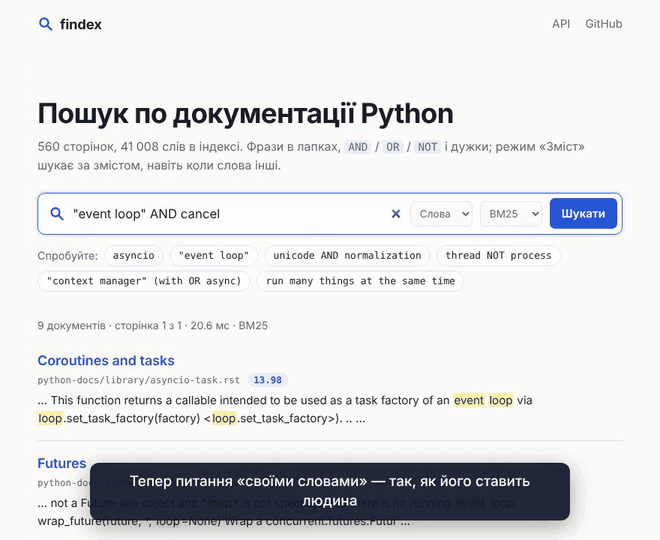
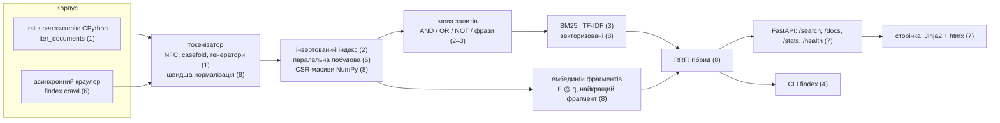

# findex

[](https://github.com/Giovann1g/findex/actions/workflows/ci.yml)

**findex — пошуковий рушій по документації Python, написаний з нуля: від токенізатора й
інвертованого індексу до BM25, семантичного пошуку на ембедингах і вебсервісу.**

**Спробувати: <https://findex-6dl0.onrender.com>** · API: [`/docs`](https://findex-6dl0.onrender.com/docs) ·
**Демо-відео (2 хв 17 с): [`docs/lab08/demo.mp4`](docs/lab08/demo.mp4)**



| 560 сторінок · 1,8 млн токенів | p95 26 мс на пошук | до 13× швидше |
|:---:|:---:|:---:|
| документація CPython, 41 008 термінів, 8 739 фрагментів з ембедингами | один клієнт, локально; гібридний режим: 14 мс | завантаження індексу 761 → 57 мс; BM25 на частому слові 8×, на синтетичному корпусі 30× |

Безкоштовний інстанс Render засинає після 15 хвилин без запитів, тож перше відкриття
може чекати до хвилини. Проєкт зроблено за 8 лабораторних курсу
[Python — Build a Search Engine](https://github.com/rmalkevy/Programming-Practice-Projects/blob/main/courses/python/README.md);
стан після кожної позначено тегом `lab-01` … `lab-08`, реліз — `v1.0.0`.

## Що він уміє

* **Три режими пошуку.** «Слова»: булеві запити (`AND`, `OR`, `NOT`, дужки, `"фрази в
  лапках"`), ранжування BM25 або TF-IDF. «Зміст»: запит і кожен фрагмент документації
  перетворено на вектор моделлю `all-MiniLM-L6-v2`, тож `measure how long my code runs`
  знаходить `profiling` і `timeit`, хоча слів запиту там немає. «Гібрид»: обидва списки,
  злиті через Reciprocal Rank Fusion.
* **Вебсторінка** з пошуком під час набору (htmx), сніпетами з підсвіткою і переглядом
  документа; **JSON API** з OpenAPI-документацією; **CLI** `findex`.
* **Корпус** з git-репозиторію CPython або з будь-якого сайту через власний асинхронний
  краулер (`findex crawl`, з `robots.txt` і лімітом на хост).

```bash
git clone https://github.com/Giovann1g/findex && cd findex && uv sync
./scripts/get_corpus.sh                                # джерела документації CPython → data/
uv run findex index data -o data/index.pkl --positions # 3 с: індекс у розкладці NumPy
./scripts/get_model.sh                                 # all-MiniLM-L6-v2 (ONNX, 90 МБ, SHA-256 перевіряється)
uv run findex embed data/index.pkl                     # ~5 хв на 2 ядрах → data/embeddings.npy
uv run findex search data/index.pkl '"event loop" AND cancel'
uv run findex search data/index.pkl "parse command line arguments" --mode hybrid
INDEX_PATH=data/index.pkl EMBEDDINGS_PATH=data/embeddings.npy CORPUS_ROOT=data uv run findex serve
docker build -t findex . && docker run --rm -p 8000:8000 findex   # або все в одному образі
```

Лише CLI, без клону: `uv tool install https://github.com/Giovann1g/findex/releases/download/v1.0.0/findex-1.0.0-py3-none-any.whl`.

## Архітектура

Число в дужках — лаба, у якій з'явилася частина.



Пакет, типи (pyright strict), тести й CI з'явилися в лабі 4; Docker і деплой на Render — у 7.
Код: `src/findex/` — `tokenize.py`, `corpus.py` (1), `index.py`, `merge.py`, `store.py` (2),
`query.py`, `rank.py`, `snippets.py` (3), `cli.py` (4), `parallel.py` (5), `crawler/` (6),
`web/` (7), `npindex.py`, `vecrank.py`, `semantic.py`, `modes.py` (8).

## Вимірювання: лаби 1–8 в одному місці

Усе виміряно на одній машині: Intel Xeon @ 2.10 GHz, 2 ядра, Linux, Python 3.13. Медіани
кількох прогонів; методика й сирі числа — у [`docs/labs.md`](docs/labs.md) і `docs/lab0*/`.

### Лаба 1. Генератори замість списків: пам'ять

| Version | Documents | Tokens | Peak memory | Elapsed |
|---|---:|---:|---:|---:|
| eager (lists) | 50 | 84,582 | 5.4 MiB | 0.13 s |
| lazy (generators) | 50 | 84,582 | 1.5 MiB | 0.13 s |
| eager (lists) | 300 | 792,713 | 47.9 MiB | 0.93 s |
| lazy (generators) | 300 | 792,713 | 3.3 MiB | 0.95 s |
| **eager (lists)** | **560** | **1,808,119** | **109.3 MiB** | **2.58 s** |
| **lazy (generators)** | **560** | **1,808,119** | **7.8 MiB** | **2.63 s** |

Пам'ять жадібної версії росте з корпусом (1,7 млн окремих `str` по ~50 байтів), лінивої —
ні: живі лише поточний документ і `Counter`. Час однаковий, бо роботу зроблено ту саму.

### Лаба 2. Індекс: булеві операції, формати, пам'ять постінгів

| Terms | df | Op | merge, µs | set, µs | merge+bisect, µs |
|---|---|---|---:|---:|---:|
| `the`, `in` | 552, 536 | AND | 40.89 | 22.97 | 50.20 |
| `the`, `in` | 552, 536 | OR | 41.33 | 20.35 | — |
| `whitacre`, `throttle` | 1, 1 | AND | 0.14 | 0.23 | 0.13 |
| `the`, `whitacre` | 552, 1 | AND | 27.81 | 4.86 | **0.23** |
| `the`, `whitacre` | 552, 1 | AND NOT | 31.82 | 10.58 | — |

| Format | File size | Save | Load | Index in RAM |
|---|---:|---:|---:|---:|
| `pickle` of `slots` | 5.6 MiB | 1355 ms | 704.6 ms | 32.8 MiB |
| `pickle` of `array` | 4.4 MiB | 149 ms | 85.4 ms | 15.2 MiB |
| `json` | 3.1 MiB | 941 ms | 490.4 ms | 31.7 MiB |
| `bin` (власний, `array('I')`) | 3.5 MiB | 119 ms | 68.1 ms | 14.0 MiB |
| `bin --lazy` (`mmap`) | 3.5 MiB | 119 ms | 56.4 ms | 6.3 MiB |

| Postings representation | Index in RAM | Build | Pickle file | Load |
|---|---:|---:|---:|---:|
| `list[Posting]`, plain `@dataclass` | 39.2 MiB | 2.90 s | 7.5 MiB | 261 ms |
| `list[Posting]`, `slots=True` | 26.6 MiB | 2.83 s | 5.6 MiB | 622 ms |
| `array('I')` pairs | 15.3 MiB | 2.77 s | 4.4 MiB | 70 ms |
| `slots=True` + positions | 97.8 MiB | 3.70 s | 11.0 MiB | 1059 ms |

`set` удвічі швидший за merge на довгих списках (хешування на C проти циклу інтерпретатора),
але на перекошеній парі «галоп» через `bisect` швидший за обидва в 21 раз. `slots` економить
40 байтів на постінг, проте pickle відновлює кожен об'єкт Python-функцією: цей самий
`__setstate__` став головним hotspot-ом лаби 8.

### Лаба 3 → 8. Якість ранжування: precision@5 на 15 запитах

Розмітка релевантних документів зроблена вручну до запуску ранжування
([`eval/queries.json`](eval/queries.json)); 5 нижніх запитів сформульовано словами, яких у
релевантних документах немає. Max P@5 — стеля, коли релевантних менше п'яти.

| # | Query | Kind | Max P@5 | TF-IDF | BM25 | Semantic | Hybrid |
|---:|---|---|---:|---:|---:|---:|---:|
| 1 | `asyncio event loop` | original | 1.0 | 0.6 | 0.8 | 0.8 | 0.8 |
| 2 | `"context manager"` | original | 0.8 | 0.2 | 0.2 | **0.6** | 0.4 |
| 3 | `generator yield` | original | 0.8 | 0.4 | 0.4 | 0.4 | 0.4 |
| 4 | `unicode normalization` | original | 0.6 | 0.6 | 0.6 | 0.6 | 0.6 |
| 5 | `lru_cache` | original | 0.4 | 0.4 | 0.4 | 0.4 | 0.4 |
| 6 | `pickle untrusted data` | original | 0.8 | 0.4 | **0.8** | 0.2 | 0.6 |
| 7 | `"global interpreter lock"` | original | 1.0 | 0.2 | 0.2 | 0.0 | 0.0 |
| 8 | `regular expression named groups` | original | 0.4 | 0.4 | 0.4 | 0.4 | 0.4 |
| 9 | `sort key function` | original | 0.8 | **0.6** | 0.2 | 0.4 | 0.2 |
| 10 | `virtual environment` | original | 0.6 | 0.4 | 0.4 | 0.6 | 0.6 |
| 11 | `pick something by chance` | paraphrase | 0.4 | 0.0 | 0.0 | 0.2 | 0.2 |
| 12 | `shrink data so it takes up fewer bytes` | paraphrase | 1.0 | 0.0 | 0.0 | 0.0 | 0.0 |
| 13 | `keep my objects on disk between program launches` | paraphrase | 1.0 | 0.0 | 0.0 | 0.4 | 0.4 |
| 14 | `how slow is my function` | paraphrase | 0.8 | 0.0 | 0.0 | 0.2 | 0.0 |
| 15 | `do several jobs at once on every core` | paraphrase | 1.0 | 0.0 | 0.0 | 0.4 | 0.4 |
| | **mean, original 10** | | **0.72** | 0.42 | **0.44** | **0.44** | **0.44** |
| | **mean, paraphrases** | | **0.84** | 0.00 | 0.00 | **0.24** | 0.20 |
| | **mean, all 15** | | **0.76** | 0.28 | 0.29 | **0.37** | 0.36 |

**Що це означає.** На парафразах пошук за словами не має шансів: «Слова» вимагає всіх
слів запиту, а `shrink`, `bytes` і `launches` разом не трапляються в жодній релевантній
сторінці, тож нуль у всіх п'яти. Семантичний пошук повертає 0,24 зі стелі 0,84: він
знаходить `multiprocessing`, `pickle`, `shelve`, `random`, але не все (на `shrink data…`
модель віддає перевагу сторінкам про `bytes` і `struct` замість `zlib`/`gzip`). На
звичайних запитах середнє однакове (0,44), але виграють вони на різному: семантика краща
там, де BM25 рахує слова фрази окремо (`"context manager"` 0,6 проти 0,2), і гірша там, де
важливе точне рідкісне слово (`pickle untrusted data` 0,2 проти 0,8: «untrusted» для
моделі майже нічого не важить). Обидва провалюються на `"global interpreter lock"`: FAQ про
GIL короткий, а `threading` і `multiprocessing` згадують `lock` сотні разів. Гібрид
(0,36) не кращий за чистий семантичний (0,37): RRF піднімає те, з чим згодні обидва
списки, і це рятує запити на кшталт `pickle untrusted data` (0,6) і `parse command line
arguments` (у відео: `argparse` першим, хоча «Слова» ставлять першим `cmd`, а «Зміст» —
`getopt`), але на парафразі, де лексичний список — шум, він цей шум підмішує. 15 запитів і
один розмітник (я) — це мало: різниця 0,01 нічого не доводить, а різниця 0,00 → 0,24 на
парафразах — так. Тому на сторінці за замовчуванням стоїть «Гібрид»: він не гірший за BM25
на звичайних запитах і знаходить те, чого BM25 не знайде взагалі.

### Лаба 4. Якість коду

| Перевірка | Лаба 4 | Лаба 8 |
|---|---|---|
| `pyright --strict` (`src/findex`) | 0 помилок | 0 помилок |
| `ruff check`, `ruff format --check` | чисто | чисто |
| `pytest` | 147 тестів, 5 властивостей Hypothesis | **284 тести** |
| покриття (рядки + гілки) | 95 % | **92 %** |

### Лаба 5. Паралельна побудова індексу (CPU-bound)

| Python | Executor | Workers | Wall (median) | Peak RSS (батько) | Speedup |
|---|---|---:|---:|---:|---:|
| 3.13 | serial | 1 | 3.89 s | 75 MiB | 1.00× |
| 3.13 | threads | 2 | 4.23 s | 96 MiB | 0.92× |
| 3.13 | threads | 8 | 4.58 s | 121 MiB | 0.85× |
| 3.13 | **processes** | **2** | **2.82 s** | 96 MiB | **1.38×** |
| 3.13 | processes | 8 | 3.67 s | 114 MiB | 1.06× |
| 3.13t (free-threaded) | **threads** | **2** | **2.88 s** | 99 MiB | **1.35×** |
| 3.13t (free-threaded) | threads | 8 | 3.24 s | 136 MiB | 1.20× |

Потоки з GIL сповільнюють CPU-роботу; процеси й free-threaded 3.13t прискорюють до межі в
2 ядра. Для порівняння, I/O-bound (`time.sleep(10 ms)` на файл) потоки з тим самим GIL
прискорюють лінійно: 1 → 32 потоки, 5.75 → 0.19 s (30×).

### Лаба 6. Асинхронний краулер (I/O-bound)

| Прогін (300 сторінок, дзеркало зі збоями) | Wall | Сторінок/с | Peak RSS |
|---|---:|---:|---:|
| asyncio, concurrency 1 | 59.08 s | 5.1 | 59 MiB |
| asyncio, concurrency 5 | 17.19 s | 17.5 | 59 MiB |
| **asyncio, concurrency 20** | **12.43 s** | **24.1** | 61 MiB |
| asyncio 20, per-host 2 | 32.28 s | 9.3 | 59 MiB |
| asyncio 20, per-host 2, пауза 0.25 s | 82.30 s | 3.6 | 59 MiB |

| Ті самі 300 адрес без збоїв | Wall | Сторінок/с | Peak RSS |
|---|---:|---:|---:|
| asyncio, 20 одночасно, один потік | **1.96 s** | **152.8** | 84 MiB |
| підхід лаби 5: процеси × 2 | 16.09 s | 18.6 | 32 MiB + ≈ 40 MiB на воркер |
| 20 потоків, блокувальний `httpx.Client` | 2.14 s | 140.4 | 256 MiB |

Один потік з 20 запитами в польоті у 8 разів швидший за два процеси: краулер чекає мережу,
а не процесор.

### Лаба 7. Вебсервіс під навантаженням

| Варіант маршруту, 20 одночасних пошуків | усього | p50 | `/health` чекав (max) |
|---|---:|---:|---:|
| `def` (у коді) | 243 ms | 209 ms | 104 ms |
| `async def`, робота на циклі | 190 ms | 105 ms | 129 ms |
| `async def` + `asyncio.to_thread` | 237 ms | 168 ms | 61 ms |

| Ціль (oha) | Concurrency | RPS | p50 | p95 | p99 |
|---|---:|---:|---:|---:|---:|
| local, 1 worker, `def` | 50 | 90 | 550 ms | 765 ms | 958 ms |
| local, 4 workers, `def` | 50 | **216** | **194 ms** | 516 ms | 706 ms |
| deployed v0.7.0 (Render free, 0.1 CPU) | 20 | 6.4 | 3293 ms | 4592 ms | 4897 ms |
| **local v1.0.0, 1 worker, «Слова»** | 1 | 68 | 13.8 ms | **26.2 ms** | 30.4 ms |
| **local v1.0.0, 1 worker, «Гібрид»** | 1 | 92 | 10.4 ms | **13.7 ms** | 14.5 ms |

Під навантаженням затримку визначає черга, а не пошук: p50 ≈ concurrency / RPS (закон
Літтла). На Render free один пошук займає ~100 мс із 0.1 CPU, тому стеля — ~10 RPS.
Останні два рядки — один клієнт без черги: стільки займає сам запит. «Гібрид» швидший за
«Слова», бо для документів із семантичного списку сніпет береться з уже знайденого фрагмента
(200 слів), а лексичному результату доводиться шукати найкраще вікно в усьому документі.

### Лаба 8. Профіль → гіпотеза → зміна → вимір

Профілі записано **до** будь-яких змін ([`profile-before.md`](docs/lab08/profile-before.md),
окремий коміт), результати — у [`profile-after.md`](docs/lab08/profile-after.md).
Flame graphs (py-spy): [пошук у CLI до](docs/lab08/flame-search-cli.svg) ·
[після](docs/lab08/flame-search-cli-after.svg) · [цикл пошуку](docs/lab08/flame-search-loop.svg) ·
[побудова індексу](docs/lab08/flame-index.svg).

| Hotspot (до змін) | Python чи native (Scalene) | Гіпотеза | Результат |
|---|---|---|---|
| `pickle.load`: 1.65 s з 2.53 s пошуку в CLI, 329 364 виклики `_dataclass_setstate` | Python (`dataclasses.py`) | постінги як масиви NumPy пишуться одним буфером | **завантаження 761 → 57 мс, RSS 180 → 33 MiB** |
| регулярка комбінованих знаків, що будується при імпорті: 0.42 s | Python (генератор на 917 232 символи) | таблиця — константа версії Unicode | 2 мс; тест звіряє таблицю з `unicodedata` |
| `rank.search`: `BM25.score` на кожен постінг | 6 % Python + 14 % у `math.log` і dict | один вираз над масивами на терм | 8× для частого слова, 0.6× для рідкісного (див. нижче) |
| побудова: `_COMBINING_RE.sub` по всьому тексту, 30 % | 100 % native | ASCII-рядки пропускати (`str.isascii()`) | 30 % → 3.6 %, побудова 3.03 → 1.83 s |

| Команда (wall, з запуском інтерпретатора) | v0.7.0 | v1.0.0 | Speedup |
|---|---:|---:|---:|
| `findex search index.pkl "asyncio event loop" -k 5` | 1.35 s | 0.30 s | 4.5× |
| `findex index data --positions --executor serial` | 5.44 s | 2.91 s | 1.9× |

**Скорер у NumPy** (`python -m findex.bench_numpy`; збіг уже в кеші, тож міряється лише
ранжування й top-k; k = 10; медіана 15 × 200 викликів):

| Query | Scorer | Docs matched | Lab 3 scorer (ms) | NumPy scorer (ms) | Speedup |
|---|---|---:|---:|---:|---:|
| frequent term `the` | BM25 | 552 | 0.421 | 0.051 | **8.2×** |
| frequent term `the` | TF-IDF | 552 | 0.258 | 0.042 | 6.1× |
| rare term `abandon` | BM25 | 2 | 0.012 | 0.020 | 0.6× |
| rare term `abandon` | TF-IDF | 2 | 0.011 | 0.017 | 0.6× |
| three terms `asyncio event loop` | BM25 | 45 | 0.126 | 0.075 | 1.7× |
| three terms `asyncio event loop` | TF-IDF | 45 | 0.085 | 0.057 | 1.5× |

Синтетичний корпус із `tests/test_benchmarks.py` (3 000 документів, слова за Ціпфом; ці ж
тести CI ганяє з `--benchmark-enable` і падає на регресії медіани > 50 %):

| Query | Lab 3 (µs) | NumPy (µs) | Speedup |
|---|---:|---:|---:|
| `w0` (у кожному документі) | 2 341 | 77 | **30×** |
| `w1 w2 w3` | 5 997 | 162 | **37×** |
| `w1999` (рідкісне) | 28 | 36 | 0.8× |

**Чому так.** Лаба 3 на кожен постінг робить виклик методу `BM25.score`, рахує `idf` через
`math.log`, кілька разів шукає в словниках і створює новий `float`, усе в інтерпретаторі: ~0,7 мкс
на постінг. NumPy робить на терм кілька C-циклів над суцільними `int32`-масивами
(`idf * tf·(k1+1) / (tf + norm[doc_ids])`), а top-k — `np.argpartition` за O(n) замість
сортування. Але кожен виклик NumPy має фіксовану ціну ~1 мкс (перевірка типів, створення
масиву-результату), і на запит їх кілька десятків: ~15–20 мкс разом. Тому виграш росте з довжиною списку постінгів:
552 постінги — 8×, 3 000 — 30×, а 2 постінги — програш (0,6×): цикл на два елементи в
Python дешевший за дюжину викликів у C. Три терміни на реальному корпусі дають лише 1,7×:
AND залишає 45 документів, і час іде на розбір запиту, кеш збігу і склеювання трьох
термів. Корпус у 560 сторінок просто замалий, щоб NumPy розігнався: найдовший список
постінгів — 552. Рейтинг **ідентичний** лабі 3, до біта у `float`: тест порівнює кожен терм, пари з AND і
OR, фрази й NOT на фікстурному корпусі (k = 1, 2, 3, 10) і випадкові корпуси Hypothesis (там рівні бали — норма, і
нічия на межі top-k вирішується за `doc_id`, так само як у `heapq.nlargest` лаби 3).

| Розкладка індексу | Файл | Завантаження | RSS після завантаження |
|---|---:|---:|---:|
| `slots` (лаби 2–7) | 11.0 MiB | 761–1036 ms | 180 MiB |
| `numpy` (CSR: один `int32`-масив `doc_ids`, один `tfs`, позиції як `offsets + flat`) | 11.7 MiB | 52–57 ms | 33 MiB |

**Семантичний пошук.** `findex embed` ріже кожен документ на фрагменти по 200 слів (разметку
reST прибрано), кодує їх `all-MiniLM-L6-v2` (ONNX Runtime, без PyTorch), нормалізує до одиничної довжини і зберігає `float32[8 739, 384]` (12,8 МіБ) плюс
`chunk → doc` у `.npy`. Пошук: запит → вектор (3,6 мс), `E @ q` (0,56 мс на всі 8 739
фрагментів), найкращий фрагмент на документ через `np.maximum.reduceat` (0,2 мс). Брутфорс тут
доречний: до сотень тисяч фрагментів це мілісекунди. Модель перевірено на еталонному виводі
`sentence-transformers` (`[0.0677, 0.0635, 0.0487, …]` для «This is an example sentence»);
косинуси з нотаток лаби: кіт/«feline» — 0,56, кіт/біржа — 0,10, «feline»/біржа — 0,08.

## Обмеження (чесно)

* **Фрази рахуються по словах.** `"global interpreter lock"` лише відбирає документи, а бал
  — сума BM25 окремих слів; тому сторінки з сотнями `lock` обходять FAQ про GIL (P@5 0,2).
  Потрібен tf самої фрази.
* **Немає стемінгу й виправлення помилок.** `profiles` не знайде `profile`; `asynco` —
  нічого. Семантичний режим частково це компенсує.
* **Модель англомовна й обрізає фрагмент до 256 word-piece-токенів.** Українські запити
  працюють погано (потрібна `paraphrase-multilingual-MiniLM-L12-v2`), а хвіст фрагмента з
  кодом, довшого за ~200 слів, моделлю не бачиться.
* **Оцінка мала:** 15 запитів, один розмітник. Різниці в 0,01–0,05 між режимами — шум.
  RRF k = 60 узято з літератури, не підібрано.
* **Індекс незмінний.** Нова сторінка = перебудова індексу (3 с) і всіх ембедингів (~5 хв на
  CPU; на Render це додає хвилини до кожного деплою). Інкрементального оновлення немає.
* **Усе в пам'яті одного процесу.** Індекс + ембединги + модель ≈ 295 МБ RSS: на 512 МБ
  free-плану Render вміщається лише один воркер, а 0.1 CPU дає ~10 RPS. Холодний старт до хвилини.
* **`pickle` небезпечний для чужих файлів.** Індекс вантажиться лише з власного образу.
* **Масштаб.** На 50 млн фрагментів `E` займе 77 ГБ і `E @ q` — секунди: потрібні HNSW
  (FAISS, hnswlib) або квантизація, а постінги — на диск (`np.memmap`) з gap-кодуванням.

**Що далі:** tf фраз і близькість слів у BM25; багатомовна модель; HNSW з виміряним
recall@10 проти брутфорсу; інкрементальний `embed` у фоновій задачі API; LLM поверх
гібридного пошуку з посиланнями на документи (RAG).

## Reflection лаби 8: коротко

1. **cProfile / py-spy / Scalene.** cProfile детерміновано інструментує кожен виклик: точна
   кількість викликів і рейтинг функцій, але накладні витрати на виклик спотворюють абсолютний
   час (генератор із 917 тис. викликів він оцінив у 0,42 с, а без профайлера це ~0,04 с). py-spy — окремий
   процес, що кілька сотень разів на секунду читає стек: майже без накладних витрат, flame
   graph; саме його чіпляють до продакшн-процесу (`py-spy record --pid`). Scalene — рядки,
   поділ часу на Python / native / system і пам'ять: показав, що `sub` по тексту — 100 %
   native, тож переписувати Python-код навколо марно, а треба рідше його викликати.
2. **`a + b` у CPython vs NumPy.** Байткод `BINARY_OP` → перевірка типів обох операндів →
   `float.__add__` → новий об'єкт `float` у купі → лічильники посилань → наступна інструкція
   циклу інтерпретатора. NumPy: один виклик, перевірка dtype один раз, далі C-цикл (часто
   SIMD) по суцільному буферу без об'єктів. Виміряно: `sum(x*x for x in range(10**6))` —
   40,5 мс, `(np.arange(10**6)**2).sum()` — 1,2 мс (35×). Для `10**2` — 2,5 проти 1,0 мкс:
   виграш падає з 35× до 2,5×, бо фіксована ціна виклику NumPy порівнянна з усією роботою.
3. **Broadcasting.** `(5, 1) * (1, 3)` → `(5, 3)`: вимір розміру 1 «розтягується» без копії
   (stride 0), але результат — повний масив N × M; для N = M = 10⁵ `float64` це 80 ГБ. У
   findex `norm[doc_ids]` — fancy indexing, а `doc_scores` — `reduceat`, без N × M.
4. **`argpartition` чи `argsort`.** `argpartition(-s, k)` — introselect, O(n): лише
   гарантує, що перші k — найбільші. Потім сортуємо тільки їх: O(n + k log k) проти
   O(n log n). Нічиї на межі в мене добрані окремо, щоб порядок збігався з лабою 3.
5. **Чому 8× на частому слові й 0,6× на рідкісному.** Робота NumPy пропорційна постінгам,
   плюс ~15–20 мкс фіксованих викликів; робота лаби 3 — ~0,7 мкс на постінг. На 552 постінгах
   виграє NumPy, на 2 — Python. На синтетичному корпусі з довшими списками — 30–37×.
6. **Ембединг.** Вектор (тут 384 числа), який мережа видає так, що тексти зі схожим змістом
   лежать поруч. Косинус дивиться на напрям, а не довжину (довжина залежить від тексту, а не
   змісту). Після нормалізації до одиничної довжини `cos(a, b) = a·b / (|a||b|) = a·b`, тож
   усі 8 739 подібностей — один матрично-векторний добуток `E @ q`.
7. **Чому фрагменти.** Вектор 30-тисячної сторінки *Built-in Types* — середнє всього, «каша».
   200 слів — одна тема. Найкращий фрагмент на документ прибирає дублікати (документ з 50
   схожими фрагментами — один результат) і дає сніпет: показуємо саме цей фрагмент.
8. **RRF.** `score(d) = Σ 1 / (60 + rank_i(d))` за обома списками. Сирі бали несумісні:
   BM25 — 0…30 і залежить від запиту, косинус — 0,2…0,7; сума слухала б BM25. Ранги однієї
   шкали, нормалізація не потрібна, а k = 60 пригашує різницю між 1-м і 3-м місцями.
9. **15 запитів.** Ключові слова програли всі 5 парафраз (0,00). Семантика програла
   `pickle untrusted data` (0,2 проти 0,8) і `"global interpreter lock"` (0,0). Гібрид
   рятує перше (0,6), але в середньому не кращий за семантику: злиття допомагає, коли обидва
   списки частково праві, і шкодить, коли один з них — шум.
10. **50 млн фрагментів.** Першою ламається пам'ять: `E` — 77 ГБ `float32`, плюс
    `E @ q` — секунди на запит (весь масив через пам'ять). Далі — побудова (дні CPU на ембединги) і індекс у pickle. Беру
    HNSW/IVF-PQ (FAISS) з квантизацією, ембединги на GPU пакетами, постінги в `memmap` з
    gap-кодуванням, і шардинг по машинах.

## Захист: 5 хвилин

1. **Живе демо** (2 хв): <https://findex-6dl0.onrender.com> (відкрити заздалегідь, щоб
   прокинувся) — `"event loop" AND cancel`, потім `measure how long my code runs` у
   «Слова» → «Зміст», потім `parse command line arguments` у трьох режимах.
2. **Вимір, яким пишаюся:** профіль показав, що 65 % часу CLI-пошуку — не пошук, а
   розпаковування 329 тис. об'єктів `Posting` з pickle. CSR-масиви: 761 → 57 мс і 180 → 33 MiB.
   Це те, що дозволило вмістити модель ембедингів у 512 МБ Render.
3. **Баг, який навчив:** cProfile «знайшов» 0,42 с у побудові таблиці Unicode при імпорті;
   без профайлера вона займала ~0,04 с (імпорт прискорився на 40 мс) — накладні витрати на 917 тис. викликів. Довіряй
   рейтингу, а не мілісекундам, і перевіряй `perf_counter`-ом. (Ще два: backlog 5 у
   `ThreadingHTTPServer` давав рівно 1,1 с на запит у лабі 6; сніпети, а не BM25, з'їдали
   99 % часу запиту в лабі 7.)

## Розробка

```bash
uv sync                                    # проєкт + dev-інструменти з uv.lock
uv run pytest                              # 284 тести; -m "not slow" — швидко
uv run pytest tests/test_benchmarks.py --benchmark-enable   # pytest-benchmark
uv run pyright && uv run ruff check . && uv run ruff format --check .
uv run python -m findex.profiling search index.pkl "asyncio event loop" --repeat 1000   # для py-spy / Scalene
uv run python -m findex.bench_numpy slots.pkl                # таблиця скорера (індекс у розкладці slots)
uv run python -m findex.evaluate index.pkl eval/queries.json --embeddings embeddings.npy  # P@5, 4 режими
```

CI (`.github/workflows/ci.yml`) на кожен push: ruff, pyright, pytest з покриттям, перевірка
wheel; job `benchmark` порівнює медіани з попереднім запуском на `main`; job `docker`
збирає образ (корпус, індекс, модель, ембединги), запускає контейнер і шукає в режимах
`lexical` і `semantic`. `release.yml` на тег `v*` публікує wheel; `loadtest.yml` — oha
проти розгорнутого сервісу. Render (`render.yaml`) перезбирає образ на push у `main`.

Детальні звіти лаб 1–7 (токенізація, формати, REPL-експерименти, sanity-check BM25, GIL,
гонка на `Counter`, краулер, маршрути API, Docker, деплой і reflection кожної лаби) —
у [`docs/labs.md`](docs/labs.md).
